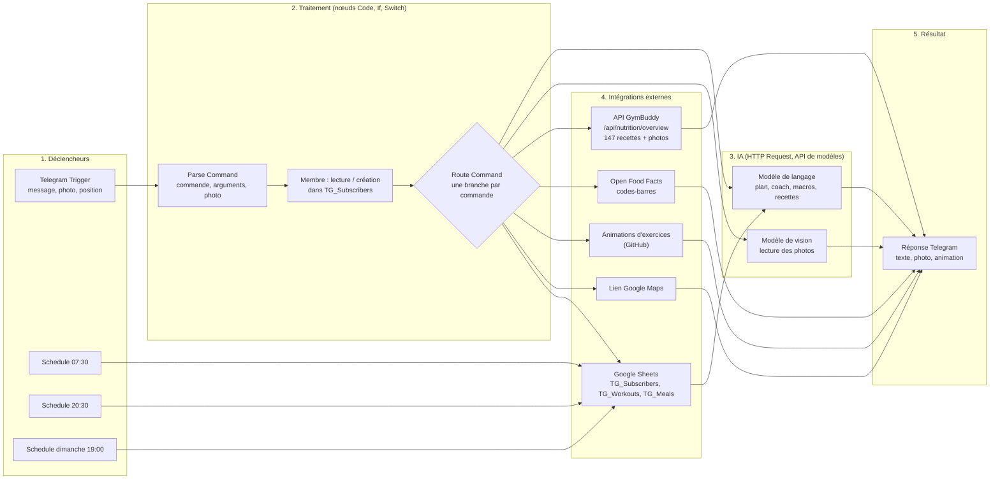

# GymBuddy AI : automatisation n8n

Ce dossier contient tout ce qu'il faut pour présenter, installer et tester l'automatisation n8n du projet GymBuddy AI. Chaque section ci-dessous répond à un point demandé dans `this what should be/PROJET.txt`.

| Point demandé | Où le trouver |
|---|---|
| Workflow n8n exporté en JSON | [`workflow_telegram_coach_media.json`](../01_Workflows_JSON/workflow_telegram_coach_media.json) (workflow principal) et deux workflows secondaires (section 1) |
| README : installation et utilisation | Sections 5 et 6 de ce fichier |
| Environnement technique | Section 3 |
| Dépendances | Section 3 |
| Schéma de l'architecture | Section 2 et [`architecture_telegram.png`](../03_Architecture/architecture_telegram.png) |
| Registre des credentials et des variables | Section 4 |
| Test de transférabilité | Section 7 et [`TEST_TRANSFERABILITE.md`](../05_Test_Transferabilite/TEST_TRANSFERABILITE.md) |
| Captures du workflow et de la conversation Telegram | Dossier [`captures/`](../06_Captures/) |

---

## 1. Les workflows livrés

| Fichier | Nœuds | Rôle |
|---|---|---|
| `workflow_telegram_coach_media.json` | 83 | **Workflow principal, en service sur n8n Cloud.** Bot Telegram de coaching : profil, plan du jour, séance, exercices avec animations, recettes du site avec leurs photos, lecture de photos, code-barres, restaurants, suivi des séances et des repas, messages programmés. |
| `workflow_gymbuddy_crm.json` | 16 | Score de 0 à 100 pour chaque membre du site, trois segments (VIP_PRO, HOT_LEAD, NURTURE), mise à jour d'une feuille Google Sheets, e-mails par segment, rapport d'indicateurs. Documentation : [`README_CRM_en.md`](./README_CRM_en.md). |
| `workflow_daily_coach.json` | 8 | Première version : message de coaching quotidien par e-mail. Gardé pour comparaison. |

`workflow_telegram_coach.json` (88 nœuds) et [`TELEGRAM_COACH.md`](./TELEGRAM_COACH.md) décrivent la version précédente du bot, qui dépendait des variables d'environnement. Elle est remplacée par la version « Media ».

Le bot fonctionne sans compte sur le site. Commandes principales :

| Message | Résultat |
|---|---|
| `/start`, `/help` | Bienvenue et liste des commandes ; l'utilisateur est enregistré dans `TG_Subscribers` |
| `/profile 22 male 175cm 72kg muscle gym 3 days halal allergy peanuts injury knee` | Profil (mots dans n'importe quel ordre, anglais ou français) et objectifs caloriques calculés avec la formule du site (Mifflin-St Jeor) |
| `/today` | Plan du jour écrit par le modèle |
| `/workout` | Séance du jour : séries, répétitions, repos |
| `/muscle chest` | Meilleurs exercices pour un muscle, avec animation |
| `/recipe`, `/recipe chicken`, `/recipe poulet riz` | Une des 147 recettes du site avec sa vraie photo, ses macronutriments, ses ingrédients et ses étapes. Les recettes qui contiennent un allergène du membre ou qui ne respectent pas son régime sont écartées |
| `/cook poulet, riz, brocoli` | Deux recettes écrites par le modèle et la photo de la recette du site la plus proche |
| Photo (assiette, machine, étiquette) | Identifiée par un modèle de vision, avec ou sans question |
| `/scan 3017620422003` ou photo d'un code-barres | Produit vérifié dans Open Food Facts |
| `/eat Rabat` ou position GPS | Recherche de restaurants sains sur Google Maps et conseils de commande |
| `/done` | Enregistre la séance, met à jour la série de jours (badges à 3, 7, 14, 30 et 50 jours) |
| `/log 2 oeufs et du pain` | Calories et macronutriments estimés, ligne ajoutée dans `TG_Meals` |
| `/report` | Bilan nutritionnel du jour |
| `/stop` | Met en pause les messages programmés |
| Tout autre texte | Réponse du coach IA, qui connaît le profil, la série et les objectifs |

Messages programmés (fuseau Africa/Casablanca) : plan du matin à 07:30, rappel à 20:30 pour ceux qui devaient s'entraîner et n'ont pas envoyé `/done` (sans appel au modèle), bilan hebdomadaire le dimanche à 19:00.

---

## 2. Schéma de l'architecture

Image : [`architecture_telegram.png`](../03_Architecture/architecture_telegram.png). Le schéma suit la chaîne demandée : déclencheur, traitement, IA, intégrations externes, résultat.

### Données échangées entre les étapes

| De | Vers | Données |
|---|---|---|
| Telegram | Parse Command | Objet `message` de Telegram : `chat.id`, `from.first_name`, `text` ou `caption`, `photo[]`, `location` |
| Parse Command | Route Command | `{ chat_id, first_name, text, command, args, photo_file_id, lang_hint, lat, lon }` |
| Google Sheets | Traitement | Ligne du membre : `chat_id`, profil (`profile_json`), objectifs, série, dernier jour d'entraînement |
| Traitement | API de modèles | `{ model, messages: [system, user], temperature, max_tokens }` ; réponse `choices[0].message.content` |
| Traitement | Modèle de vision | Image Telegram convertie en data URL + question éventuelle |
| API GymBuddy | `/recipe`, `/cook` | Liste des recettes : nom, calories, protéines, glucides, lipides, ingrédients, étapes, `image_url` |
| Open Food Facts | `/scan` | `product_name`, `nutriments` |
| Traitement | Telegram | `sendMessage` (texte), `sendPhoto` (URL de la photo de la recette), `sendAnimation` (exercice) |

Chaque nœud HTTP et Google Sheets continue en cas d'erreur et chaque message IA a un texte de repli, donc le membre reçoit toujours une réponse.

---

## 3. Environnement technique et dépendances

**Environnement**

- n8n Cloud (recommandé : l'adresse publique du webhook Telegram fonctionne directement). Instance utilisée par l'équipe : `gymbuddyy.app.n8n.cloud`.
- Ou n8n auto-hébergé (version 1.60 ou plus, testé en 2.46) avec une adresse HTTPS publique : `npx n8n start --tunnel`, ngrok ou cloudflared. Le script [`start-n8n.ps1`](./start-n8n.ps1) lance n8n en local sous Windows.
- Un compte Telegram et un compte Google.

**Dépendances**

| Dépendance | Détail |
|---|---|
| Nœuds n8n | Uniquement des nœuds intégrés : Telegram Trigger (1), Telegram (8), Schedule Trigger (3), Code (40), Google Sheets (12), HTTP Request (10), If (8), Switch (1). Aucun plugin communautaire |
| API GymBuddy | `https://gymbuddy-api-zeta.vercel.app/api/nutrition/overview` (recettes et photos), sans clé |
| API de modèles | OpenRouter, `https://openrouter.ai/api/v1/chat/completions` (7 nœuds HTTP : texte et vision) |
| Open Food Facts | `https://world.openfoodfacts.org/api/v2/product/<code>.json`, sans clé |
| Animations d'exercices | Jeu public d'images hébergé sur GitHub, sans clé |
| Google Sheets | Une feuille avec les onglets `TG_Subscribers`, `TG_Workouts`, `TG_Meals` (en-têtes : [`tg_subscribers.csv`](../04_Modeles_Google_Sheets/tg_subscribers.csv), [`tg_workouts.csv`](../04_Modeles_Google_Sheets/tg_workouts.csv), [`tg_meals.csv`](../04_Modeles_Google_Sheets/tg_meals.csv)) |
| Variables d'environnement | Aucune. n8n Cloud bloque `$env`, donc les adresses sont écrites dans les nœuds et les secrets sont dans les credentials n8n |

---

## 4. Registre des credentials et des variables

Les credentials ne sont pas exportés avec le JSON : il faut les recréer sur chaque nouvelle machine.

| Nom dans n8n | Type | Service | Droits requis | Nœuds | Création sur une nouvelle machine |
|---|---|---|---|---|---|
| `Telegram account` | Telegram API | Bot Telegram | Recevoir les messages envoyés au bot, envoyer messages, photos et animations | 9 | Telegram : ouvrir `@BotFather`, envoyer `/newbot`, choisir un nom, copier le jeton. Dans n8n : *Credentials, Create, Telegram API*, coller le jeton |
| `Google Sheets account` | Google Sheets OAuth2 API | Google Sheets | Lire et écrire les trois onglets `TG_` (portée `spreadsheets`) | 12 | n8n : *Credentials, Create, Google Sheets OAuth2 API*, *Sign in with Google*, accepter l'accès. En auto-hébergé, il faut d'abord un client OAuth dans Google Cloud Console |
| `Header Auth account` | Header Auth | API de modèles (OpenRouter) | Appels de génération de texte et de vision | 7 | Créer une clé sur https://openrouter.ai/keys. n8n : *Credentials, Create, Header Auth*, nom `Authorization`, valeur `Bearer <clé>` |

| Valeur à adapter | Où | Comment |
|---|---|---|
| Identifiant de la feuille Google | 12 nœuds Google Sheets | Ouvrir le JSON dans un éditeur de texte, remplacer `REPLACE_WITH_GOOGLE_SHEET_ID` par l'identifiant de votre feuille (la partie de l'URL entre `/d/` et `/edit`), *Remplacer tout* |
| Fuseau horaire | *Workflow settings* | Choisir `Africa/Casablanca` (sinon les messages de 07:30, 20:30 et 19:00 partent à l'heure du serveur) |
| Adresse de l'API GymBuddy | Nœuds HTTP des recettes | Déjà écrite (`https://gymbuddy-api-zeta.vercel.app`). À changer seulement si l'API est déployée ailleurs |

---

## 5. Installation sur une nouvelle machine (environ 15 minutes)

1. **Créer le bot** : dans Telegram, `@BotFather`, `/newbot`, copier le jeton.
2. **Préparer la feuille** : créer une feuille Google avec trois onglets nommés exactement `TG_Subscribers`, `TG_Workouts`, `TG_Meals`, et coller dans chacun la ligne d'en-tête du fichier CSV correspondant.
3. **Mettre l'identifiant de la feuille** dans le JSON (section 4, *Remplacer tout*).
4. **Importer** : n8n, *Workflows, Import from File*, choisir `workflow_telegram_coach_media.json`.
5. **Créer les trois credentials** (section 4) et les choisir sur les nœuds qui affichent un avertissement rouge.
6. **Régler le fuseau horaire** : *Workflow settings*, `Africa/Casablanca`.
7. **Publier** le workflow (bouton *Publish* en haut à droite). Telegram n'envoie les messages qu'à un workflow publié. Un seul workflow peut utiliser le même bot à la fois : si n8n affiche « There is a conflict with one of the webhooks », dépublier l'autre copie.
8. **Tester** : envoyer `/start` au bot, puis les messages de la section 6.

## 6. Utilisation et vérification

Envoyer au bot, dans cet ordre :

1. `/start`
2. `/profile 22 male 175cm 72kg muscle gym 3 days`
3. `/today` puis `/workout`
4. `/muscle chest`
5. `/recipe chicken` : la photo de la recette du site doit arriver
6. une photo de votre assiette
7. `3017620422003`
8. `/eat Rabat`
9. `/done`, `/log 2 oeufs et du pain`, `/report`

Dans n8n, l'onglet *Executions* doit montrer une exécution réussie par message. Dans la feuille, `TG_Subscribers`, `TG_Workouts` et `TG_Meals` doivent avoir de nouvelles lignes. Pour tester les messages programmés sans attendre, ouvrir le nœud *Every Day 07:30* et cliquer *Execute step*.

Limites à connaître : le fournisseur de modèles limite le nombre de requêtes par jour (le rappel du soir, `/workout`, `/recipe`, `/eat`, `/done` et `/report` n'appellent pas le modèle) ; la recherche de restaurants renvoie un lien Google Maps et non une liste vérifiée.

---

## 7. Test de transférabilité

**Premier transfert (fait)** : du n8n local (Windows, `npx n8n start`, n8n 2.46) vers n8n Cloud, les 24 et 25 novembre 2026.

| Point observé | Résultat |
|---|---|
| Ce qui a fonctionné sans aide | Import du JSON, tous les nœuds (aucun plugin), webhook Telegram sans tunnel |
| Points de blocage | 52 utilisations de `$env` bloquées par n8n Cloud ; credentials non exportés avec le JSON ; fuseau horaire différent ; étape photo qui plantait |
| Corrections | `$env` remplacés par des adresses dans les nœuds et des credentials ; fuseau Africa/Casablanca ; étape photo reconstruite ; ce README complété (registre des credentials, identifiant de la feuille, conflit de webhook) |

**Second transfert (à faire avec un ami)** : donner à une personne extérieure à l'équipe uniquement ce dossier `automation/`, la laisser installer le bot sur son propre compte n8n avec son propre bot Telegram, et remplir la fiche [`TEST_TRANSFERABILITE.md`](../05_Test_Transferabilite/TEST_TRANSFERABILITE.md). La réflexion qui en sort va dans le tableau 12 du rapport.

---

## Crédits

Le bot part de deux modèles communautaires publiés sur n8n.io : n° 7756 de John Alejandro Silva (suivi des repas avec Telegram et Google Sheets) et n° 16969 de Dr. Firas (coach Telegram avec profil et historique). Aucun des deux n'envoie de messages programmés ni ne connaît le programme d'entraînement de l'utilisateur. Notre version ajoute les recettes du site GymBuddy avec leurs photos, la lecture de photos, les séries, les badges, le rappel du soir et le bilan hebdomadaire.
