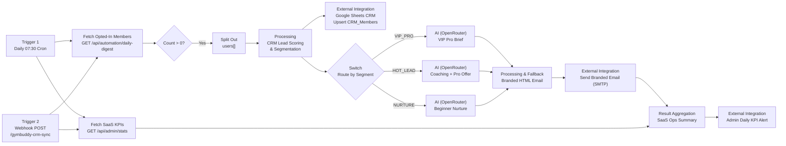

# GymBuddy AI — SaaS CRM & Daily Coaching Automation (n8n)

This folder contains all deliverables for the **Automation (n8n)** part of the assignment (`this what should be/PROJET.txt`):
- **Exported n8n CRM + AI Workflow (v2 — 16 nodes):** [`workflow_gymbuddy_crm.json`](./workflow_gymbuddy_crm.json)
- **Ready-to-import SaaS CRM Template (Google Sheets / Airtable / Notion):** [`crm_template.csv`](./crm_template.csv)
- **NEW — Telegram Coach bot + reminders (65 nodes):** [`workflow_telegram_coach.json`](./workflow_telegram_coach.json), setup and credits in [`TELEGRAM_COACH.md`](./TELEGRAM_COACH.md) (sheet headers: `tg_*.csv`)
- *(Legacy v1 basic workflow kept for comparison: [`workflow_daily_coach.json`](./workflow_daily_coach.json))*
- Installation & usage guide, technical environment, dependencies, architecture diagram, credentials registry, and transferability test template (below).

---

## 1. Objective & SaaS Features
This 16-node n8n workflow automates **both member coaching and SaaS CRM operations** for GymBuddy AI:
1. **Dual Triggers:** Runs automatically every morning at **07:30** (`Schedule Trigger`) **OR** on-demand via `POST /webhook/gymbuddy-crm-sync` (for live demos or instant new-lead sync).
2. **Live API Integration:** Fetches opted-in users (`/api/automation/daily-digest`) AND real-time SaaS health KPIs (`/api/admin/stats`: user count, 👍/👎 chatbot ratings, user bug reports) from our deployed Vercel API (`https://gymbuddy-api-zeta.vercel.app`).
3. **CRM Lead Scoring & Segmentation Engine:** Scores every member from `0–100` based on plan tier, training commitment, diet restrictions, and injuries, and classifies them into 3 actionable SaaS CRM segments:
   - `VIP_PRO` — Active Pro subscribers → VIP workout + progressive overload brief + direct link to **In-Gym Chrono**.
   - `HOT_LEAD` — High-intent Free users (score ≥ 55) → daily plan + personalized pitch to try **GymBuddy Pro**.
   - `NURTURE` — Free beginners → warm, guilt-free onboarding message + link to the **Interactive Muscle Map**.
4. **Google Sheets SaaS CRM Sync:** Automatically **upserts** (creates or updates by `email`) every member in the `CRM_Members` sheet (`crm_template.csv`).
5. **Segmented AI Generation + Branded HTML Email:** Calls OpenRouter (`openrouter/free`) with a tailored prompt per segment, wraps the output in a **Metrya-branded HTML email** (`#08130D` dark forest header + `#DAF85A` electric lime CTA button), and includes a **deterministic fallback** if the LLM API fails.
6. **Admin Daily KPI & Bug-Report Alert:** Aggregates emails sent, segment counts, AI success rate, chatbot 👍/👎 ratings, and open bug reports, and sends an **Admin Ops Digest** email to the team.

---

## 2. Architecture Diagram (Trigger → Processing → CRM → AI → External Integrations → Result)

### Data exchanges between stages
- **Backend API → n8n:** JSON `{ date, count, users: [{ user_id, email, name, plan, goal, today_workout, equipment, calories, protein_g, water_l, diet, allergies, injuries }] }` and `/api/admin/stats` `{ users, assistant_messages, thumbs_up, thumbs_down, feedback[] }`.
- **CRM Scoring → Google Sheets:** Upserts 15 columns matched on `email` (`user_id`, `name`, `email`, `plan`, `segment`, `lead_score`, `churn_risk`, `goal`, `equipment`, `calories_target`, `protein_g`, `today_workout`, `last_contacted`, `status`, `next_action`).
- **Segment Router → OpenRouter AI:** Sends user JSON + segment-specific coaching system prompt; receives `{ choices: [{ message: { content } }] }`.
- **HTML Builder → SMTP:** Outputs `{ email, subject, body_html, used_ai, segment, sent_at }`.

---

## 3. SaaS CRM Template (`crm_template.csv`)
Import [`crm_template.csv`](./crm_template.csv) into **Google Sheets** (*File → Import → Upload*), rename the tab to **`CRM_Members`**, and copy the Sheet ID from the URL (`https://docs.google.com/spreadsheets/d/<SHEET_ID>/edit`).

| Column | Purpose | Example |
|---|---|---|
| `user_id`, `name`, `email` | Member identity (upsert key = `email`) | `achraf.demo@example.com` |
| `plan` | SaaS tier (`free` or `pro`) | `pro` |
| `segment` | Auto-assigned lifecycle segment | `VIP_PRO`, `HOT_LEAD`, `NURTURE` |
| `lead_score` | Computed conversion/engagement score (`0–100`) | `92` |
| `churn_risk` | Retention indicator (`Low`, `Medium`, `High`) | `Low` |
| `goal`, `equipment`, `calories_target`, `protein_g`, `today_workout` | Fitness personalization data from GymBuddy API | `build_muscle`, `2650`, `Push` |
| `last_contacted`, `status`, `next_action` | CRM pipeline tracking & next follow-up | `Active Pro`, `Deliver VIP coaching` |

---

## 4. Technical Environment & Dependencies
- **n8n:** v1.60+ (local `npx n8n`, Docker, or n8n Cloud)
- **Nodes used:** 100% built-in core nodes (`scheduleTrigger`, `webhook`, `httpRequest`, `if`, `splitOut`, `code`, `googleSheets`, `switch`, `emailSend`) — **zero community plugins required**.
- **GymBuddy Backend API:** Deployed live at `https://gymbuddy-api-zeta.vercel.app` (or locally at `http://localhost:8000`).
- **AI Provider:** OpenRouter (`openrouter/free`, free tier) or Google Gemini.
- **CRM & Mail:** Google Sheets (free Google account) + Gmail SMTP (App Password) or Mailtrap/Brevo.

---

## 5. Credentials & Environment Variables Registry

| Name | Type | Service | Required permissions | How to set up on a new machine |
|---|---|---|---|---|
| `GYMBUDDY_API_URL` | Env var | GymBuddy FastAPI | Read API | Default: `https://gymbuddy-api-zeta.vercel.app` (or `http://localhost:8000`) |
| `GYMBUDDY_API_KEY` | Env var (secret) | GymBuddy FastAPI | `X-API-Key` for `/daily-digest` & `/admin/stats` | Must match `AUTOMATION_API_KEY` (`change-me` by default) |
| `LLM_ENDPOINT` | Env var | OpenRouter / Gemini | Chat completions | Default: `https://openrouter.ai/api/v1/chat/completions` |
| `LLM_MODEL` | Env var | OpenRouter | Model inference | Default: `openrouter/free` |
| `LLM_API_KEY` | Env var (secret) | OpenRouter | Text generation | Create free key at https://openrouter.ai/keys |
| `CRM_GOOGLE_SHEET_ID` | Env var | Google Sheets | Read/Write `CRM_Members` | Copy the ID from your imported Google Sheet URL |
| `SMTP_FROM_EMAIL` | Env var | Gmail / SMTP | Send email | Sender address (e.g. `yourname@gmail.com`) |
| `ADMIN_ALERT_EMAIL` | Env var | Gmail / SMTP | Receive KPI digest | Admin/team email address |
| `GymBuddy Google Sheets` | n8n Credential (`googleSheetsOAuth2Api`) | Google Cloud OAuth2 | `spreadsheets` scope | In n8n → **Credentials → New → Google Sheets OAuth2** → sign in with Google |
| `GymBuddy SMTP` | n8n Credential (`smtp`) | Gmail / Brevo / Mailtrap | Send email | Host `smtp.gmail.com`, port `465`, SSL/TLS ON, user = Gmail, password = 16-char Google App Password |

---

## 6. Installation & Usage on a New Machine
1. Import [`crm_template.csv`](./crm_template.csv) into Google Sheets and name the tab `CRM_Members`.
2. Start n8n (Docker or `npx n8n start`) with the environment variables above.
3. Open `http://localhost:5678` → **Workflows → Import from File** → select [`workflow_gymbuddy_crm.json`](./workflow_gymbuddy_crm.json).
4. Attach your **GymBuddy Google Sheets** and **GymBuddy SMTP** credentials on the corresponding nodes.
5. Make sure at least one user on https://gymbuddy-ai-phi.vercel.app has an email + **"Opt in to the daily coaching email"** enabled.
6. Click **Test Workflow** (or trigger the Webhook URL) and verify:
   - The member row is created/updated in `CRM_Members` with `segment` and `lead_score`.
   - The member receives the branded dark-forest & electric-lime HTML coaching email.
   - You receive the **Admin Daily KPI Digest** email.

---

## 7. Transferability Test (To Fill After Testing With a Friend)
> **Requirement from `PROJET.txt`:** Invite a friend (giving them only these documents + the JSON + `crm_template.csv`) to set up and run the automation on their own machine, then write a reflection on the experience.

- **Tester name & date:** _[Fill after test]_
- **Environment used:** _[e.g., Windows 11 + n8n + Google Sheets + Gmail SMTP]_
- **Time taken to set up:** _[e.g., 20 minutes]_
- **What worked smoothly:** _[e.g., CSV import into Google Sheets, JSON workflow import, live Vercel API call]_
- **Friction points encountered:** _[e.g., Google OAuth2 / Gmail App Password setup]_
- **Improvements made to the docs after the test:** _[list what you clarified]_
