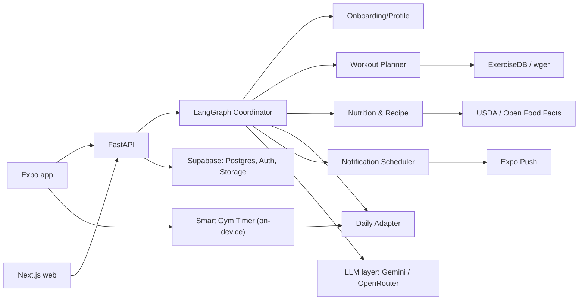

# Gym SaaS: Design Decisions (from the grill-me session)

## Product
A simple SaaS that runs a user's whole gym life: daily schedule, workout split, exercises, goal (lose weight / lean / bulk…), meals and recipes, weekly freezer meal prep, and healthy restaurant suggestions, all delivered through notifications.

| # | Topic | Decision |
|---|-------|----------|
| 1 | Plan creation | AI agents generate the full plan (split, exercises, meals, recipes, notifications) from a detailed onboarding questionnaire |
| 2 | Platforms | Web dashboard (Next.js) + native iOS/Android app (React Native/Expo) for push notifications |
| 3 | Plan updates | Continuous: the user logs every day and the agent adapts the next day's plan |
| 4 | Logging | Quick check-off (done / skipped / swapped, optional sets/reps/weight) + meal photo analysis |
| 5 | Restaurants | Phone location + Google Places API; the agent picks the best dish for today's macros |
| 6 | Business model | Freemium: free basic plan; paid = AI adaptation, photo logging, restaurant suggestions |
| 7 | Stack | FastAPI + LangGraph (Python) backend, Next.js web, React Native/Expo mobile |
| 8 | LLMs | Works with any provider: Gemini + free OpenRouter models for testing; Claude/GPT later |
| 9 | Recipes & nutrition | The agent writes recipes; macros/calories computed from USDA FoodData Central / Open Food Facts |
| 10 | Meal prep | User-chosen prep day → batch-cooking list, grocery list, freezer storage + reheating instructions |
| 11 | Safety | Questionnaire captures injuries, allergies, medical conditions; hard limits enforced (min calories, no allergens, safe weight-loss rate) + medical disclaimer |
| 12 | Exercises | Exercise library with target muscles, instructions, demo GIF/video (ExerciseDB / wger) |
| 13 | Languages | English, French, Arabic (RTL), Spanish |
| 14 | Scope | Phased (see below) |
| 15 | Data & auth | Supabase: Postgres, auth (email / Google / Apple), storage for meal photos; FastAPI talks to it |
| 16 | Agents | Multi-agent LangGraph: Coordinator → Onboarding/Profile, Workout Planner, Nutrition & Recipe, Daily Adapter, Notification Scheduler; later Meal Photo Analyzer, Restaurant Finder |
| 17 | Notification timing | From the questionnaire (wake time, work hours, preferred gym time); the user can edit times and mute categories |
| 18 | Location | User will create a new folder and open it as a new workspace |

## Smart Gym Session Timer (signature feature)
A guided, full-screen session clock used during the workout (mobile first, also on web).

**Core behavior**
- Big clock + current step: **"Exercise: Bench Press, Set 2/4, 10 reps @ 60 kg"** → **"Rest 1:30"** → next set.
- Timed exercises (plank, cardio) count down; rep-based sets wait for **"Set done"**, then the rest countdown starts automatically.
- Audio cues, vibration, and voice ("3, 2, 1… go", "Rest", "10 seconds left"); works with the screen locked (lock-screen notifications / Live Activity on iOS, ongoing notification on Android).
- Rest time comes from the plan (e.g., strength 2–3 min, hypertrophy 60–90 s, circuits 30 s); **+15 s / skip rest** buttons.
- Log weight/reps right on the timer screen (pre-filled from progressive overload); this is the check-off logging.

**"Equipment busy" mode**
- **Pause** button freezes the clock without breaking the session (a separate "waiting" timer is shown).
- Options while paused: **wait**, **do the next exercise first** (reorder), or **swap** for an alternative that targets the same muscles with free equipment (Daily Adapter agent / exercise library).
- The agent remembers frequently busy equipment and busy hours, and over time suggests better gym times or a default alternative.

**Hydration cues**
- Water reminders during rest periods (never mid-set), based on session length, intensity, body weight, and heat (and the Ramadan/fasting window, so no water reminders while fasting).
- A tap logs a sip/bottle → feeds the daily water goal.

**Session summary**
- Total time, active vs. rest vs. waiting time, volume lifted, PRs, water drunk → saved to the log, and the agent adapts tomorrow.

**Free vs. Pro:** the basic timer is free (it's a hook to bring users back daily); smart swaps, busy-hours insights, and voice coaching are Pro.

## Roadmap (with the features adopted from the market research)
- **MVP:** questionnaire (incl. equipment/location, pantry, budget, cooking time, halal, fasting/Ramadan, injuries/allergies) → agent-generated plan → daily dashboard + push notifications + check-off logging (web + mobile) · **Smart Gym Session Timer** (core + pause/reorder/swap + water cues) · one-tap swaps ("no time → 20-min workout", swap meal/exercise) · progressive overload · adaptive calorie targets from the weight trend · water & sleep reminders · guilt-free streaks · i18n (EN/FR/AR-RTL/ES) · safety guardrails · exercise library · recipes with real macros.
- **Phase 2:** meal photo logging + barcode scan (Open Food Facts) · restaurant finder (Google Places + macros) · weekly freezer meal prep + smart grocery list (staples memory, grouped by aisle) · pantry/budget-aware recipes · **Ramadan mode** (Suhoor/Iftar from prayer times, workouts after Iftar) · halal filter + MENA dish database · household/family portion scaling · Stripe payments / freemium gating + regional payments.
- **Phase 3:** Apple Health / Google Health Connect sync (steps, sleep, heart rate, smart-scale weight) · Apple Watch / Wear OS timer companion · progress photos + measurements · restaurant menu photo scan · grocery delivery integrations · community challenges / accountability partner · AI form check · coach/gym B2B dashboard · add Claude/GPT models.

