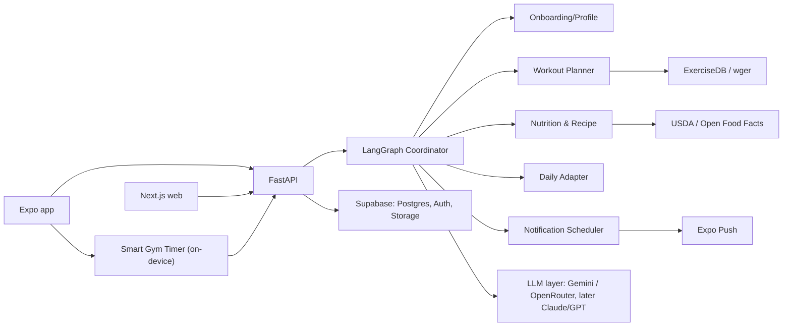

# Gym SaaS: Complete Project Specification

> Everything agreed so far, in one file: the original vision, the grill-me decisions, the market research, the adopted features, and the Smart Gym Session Timer.
> Details: [docs/DECISIONS.md](docs/DECISIONS.md) · [docs/MARKET_RESEARCH.md](docs/MARKET_RESEARCH.md)

---

## 1. Vision (what the user asked for)
A **simple** SaaS website + mobile app that handles every detail of your gym life:
- Daily **notifications**: when to eat, when to go to the gym, what exercises to do that day.
- Shows your **gym split** (Push/Pull/Legs, Upper/Lower, Full body…).
- Shows your **goal / intention** (lose weight, get lean, build muscle…).
- **Recipes** for every meal of the day.
- **Weekly meal prep**: meals to cook ahead and keep in the freezer.
- **Healthy restaurant suggestions** when you're eating out.
- **Smart Gym Session Timer** that tells you when to exercise and when to rest, can be paused when equipment is busy, and reminds you to drink water.
- Powered by **AI agents**: the client fills in a questionnaire, and the agents build and run the whole plan.

---

## 2. Core Decisions (grill-me session)
| # | Topic | Decision |
|---|-------|----------|
| 1 | Plan creation | AI agents generate the full plan (split, exercises, meals, recipes, notification schedule) from a detailed onboarding questionnaire |
| 2 | Platforms | Web dashboard (Next.js) + native iOS/Android app (React Native/Expo) for push notifications |
| 3 | Plan updates | **Continuous**: the user logs daily and the agent adapts the next day |
| 4 | Logging | Quick check-off (done / skipped / swapped, optional sets/reps/weight) **+** meal photo analysis |
| 5 | Restaurants | Phone location + Google Places API; the agent picks the best dish for today's remaining macros |
| 6 | Business model | **Freemium**: free basic plan; paid = AI adaptation, photo logging, restaurant suggestions, smart timer extras |
| 7 | Backend | Python **FastAPI + LangGraph** |
| 8 | Frontend | **Next.js** (web) + **React Native / Expo** (mobile) |
| 9 | LLMs | Works with any provider: **Gemini + free OpenRouter models** for testing; **Claude / GPT** later |
| 10 | Recipes & nutrition | The agent writes recipes; calories/macros computed from **USDA FoodData Central / Open Food Facts** |
| 11 | Meal prep | User-chosen prep day → batch-cooking list, grocery list, freezer storage + reheating instructions |
| 12 | Safety | Questionnaire captures injuries, allergies, medical conditions; hard limits enforced (min calories, no allergens, safe weight-loss rate) + medical disclaimer |
| 13 | Exercises | Exercise library: target muscles, instructions, demo GIF/video (**ExerciseDB / wger**) |
| 14 | Languages | **English, French, Arabic (RTL), Spanish** |
| 15 | Data & auth | **Supabase**: Postgres + auth (email / Google / Apple) + storage (meal photos) |
| 16 | Agents | Multi-agent LangGraph (see §5) |
| 17 | Notification timing | From the questionnaire (wake time, work hours, preferred gym time); the user can edit times and mute categories |
| 18 | Release strategy | Phased (see §8) |
| 19 | Project folder | `c:\Users\achra\Videos\gym app` |

---

## 3. Feature List

### 3.1 Onboarding questionnaire
- Body data: age, sex, height, weight, activity level.
- Goal: lose weight / get lean / build muscle / recomposition / maintain; target pace.
- Training: experience level, days per week, session length, preferred split, **equipment & location** (full gym / home dumbbells / hotel / bodyweight).
- Schedule: wake time, work hours, preferred gym time, meal-prep day.
- Food: diet type, **halal**, allergies, dislikes, **pantry staples**, **budget**, **max cooking time**, household size, **fasting / Ramadan**.
- Health: injuries, medical conditions → safety guardrails.
- Language & notification preferences.

### 3.2 Daily plan & dashboard
- Today's goal, gym split, workout, meals + recipes, water target, sleep target.
- Timeline of the day with all reminders.
- **One-tap swaps**: swap a meal, swap an exercise, "no time today → give me a 20-min workout".
- Guilt-free streaks and gentle messages.

### 3.3 Notifications
- Meal times, gym time, workout of the day, water, sleep, meal-prep day, grocery reminder.
- Editable times, mute per category.

### 3.4 Workouts
- Gym split + daily exercises from the exercise library (GIF/video + instructions).
- **Progressive overload**: suggested weight/reps from the last session.
- Plans fit the available equipment.

### 3.5 ⏱️ Smart Gym Session Timer (signature feature)
**Guided clock**
- Big clock + current step: *"Bench Press, Set 2/4, 10 reps @ 60 kg"* → *"Rest 1:30"* → next set.
- Timed exercises (plank, cardio) count down; rep-based sets wait for **"Set done"**, then rest starts automatically.
- Sound, vibration, and voice cues ("3, 2, 1… go", "Rest", "10 seconds left"); works with the screen locked (iOS Live Activity / Android ongoing notification).
- Rest durations come from the plan (strength 2–3 min, hypertrophy 60–90 s, circuits ~30 s); **+15 s** and **skip rest** buttons.
- Log weight/reps directly on the timer screen (pre-filled by progressive overload).

**Equipment busy / gym full**
- **Pause** freezes the session clock (a separate "waiting" timer runs).
- Options: **wait**, **do the next exercise first**, or **swap** for an alternative that targets the same muscles with free equipment.
- The agent learns frequently busy equipment and busy hours → suggests better gym times / default alternatives.

**Hydration**
- Water reminders **during rest only** (never mid-set), based on session length, intensity, body weight, and heat.
- Disabled during fasting hours (Ramadan / fasting mode).
- One tap logs water → counts toward the daily water goal.

**Session summary**
- Total time, active / rest / waiting time, volume lifted, PRs, water drunk → saved, and the agent adapts tomorrow.

**Free vs. Pro**: the basic timer is free; smart swaps, busy-hours insights, and voice coaching are Pro.

### 3.6 Nutrition
- Daily meals with recipes (real macros from the nutrition databases).
- **Calorie targets that adjust** from the weight trend + logs (MacroFactor-style).
- **Pantry / budget / time-aware recipes** (use what's in the fridge, cheap, max X minutes).
- **Household mode**: scale recipes for the family, with the user's portion highlighted.
- **Halal filter + MENA dish database** (tajine, couscous, harira, kabsa…).
- **Ramadan mode**: Suhoor / Iftar schedule from local prayer times, workouts placed after Iftar or kept light before it, hydration plan between Maghrib and Fajr.

### 3.7 Weekly meal prep
- User-chosen prep day → batch-cooking plan, freezer storage + reheating instructions.
- **Smart grocery list**: grouped by store aisle, remembers staples, avoids waste.

### 3.8 Logging
- Quick check-off (done / skipped / swapped).
- Meal **photo** logging (AI estimate) + **barcode scan** (Open Food Facts).
- Weight log; water log; workout log (from the timer).

### 3.9 Eating out
- Location + Google Places → nearby healthy restaurants → the agent suggests the best dish for today's remaining macros.
- Later: snap a **menu photo** → best choice.

### 3.10 Later / premium
- Apple Health / Google Health Connect sync (steps, sleep, heart rate, smart-scale weight).
- Apple Watch / Wear OS companion for the timer.
- Progress photos + body measurements (monthly side-by-side comparison).
- Grocery delivery integrations (Instacart, Glovo, Carrefour…).
- Community challenges / accountability partner.
- AI form check (record a set → feedback).
- Coach / gym B2B dashboard (trainers manage clients with the same agents).

---

## 4. Safety Guardrails
- Minimum calorie floor, maximum weekly weight-loss rate.
- Allergens are never suggested; exercises that conflict with injuries are excluded.
- High-risk profiles → "see a doctor/dietitian first" prompt.
- Medical disclaimer at onboarding and in settings.

---

## 5. Architecture

### Agents (LangGraph)
| Agent | Role | Phase |
|---|---|---|
| **Coordinator** | Routes requests to the specialist agents | MVP |
| **Onboarding / Profile** | Turns questionnaire answers into a validated profile + targets | MVP |
| **Workout Planner** | Split, exercises, sets/reps/rest, progressive overload, equipment fit | MVP |
| **Nutrition & Recipe** | Meals, recipes, macros (via nutrition DB), meal prep, grocery list | MVP |
| **Daily Adapter** | Reads logs + timer sessions → adapts the next day; handles swaps | MVP |
| **Notification Scheduler** | Builds the daily reminder timeline | MVP |
| **Meal Photo Analyzer** | Photo → foods + macros | Phase 2 |
| **Restaurant Finder** | Places + menu → best dish | Phase 2 |



### External services
Supabase · Expo Push · Google Places · USDA FoodData Central · Open Food Facts · ExerciseDB / wger · prayer-times API (Ramadan mode) · Stripe (+ regional payments later) · Gemini / OpenRouter.

---

## 6. Business Model
- **Free**: questionnaire, basic plan, daily reminders, basic gym timer, check-off logging.
- **Pro (~\$7–10/mo or ~\$50–70/yr, regional pricing for MENA)**: continuous AI adaptation, photo logging, restaurant suggestions, smart timer extras (swaps, busy-hour insights, voice coaching), meal prep + smart grocery list, advanced features.

---

## 7. Competitors & Positioning (summary)
- **Single-area apps**: Fitbod / FitnessAI (workouts), MacroFactor / MyFitnessPal / Cal AI (nutrition tracking), Eat This Much (meal planning), MenuFit and similar (restaurants), Future (human coach, ~\$199/mo).
- **Emerging all-in-one** (unverified): Siloh, Trainera, ForgeFit, PrivaFit.
- **MENA**: Sihha Fit, ElCoach.
- **Our edge**: one agent runs the whole day and pushes it to you · freezer meal prep + restaurants in one plan · Smart Gym Session Timer · Arabic/French/MENA + Ramadan support.
- **Design against churn**: low-effort logging, flexible swaps, variety, guilt-free tone, realistic recipes, fair paywall.

---

## 8. Roadmap
**MVP**
- Questionnaire (full, incl. equipment, pantry, budget, halal, fasting, health) → agent-generated plan.
- Daily dashboard + push notifications + check-off logging (web + mobile).
- **Smart Gym Session Timer** (guided clock, pause / reorder / swap, water cues, summary).
- One-tap swaps · progressive overload · adaptive calorie targets · water & sleep reminders · streaks.
- Exercise library · recipes with real macros · safety guardrails · i18n EN/FR/AR (RTL)/ES.

**Phase 2**
- Meal photo logging + barcode scan · restaurant finder.
- Weekly freezer meal prep + smart grocery list · pantry/budget-aware recipes · household scaling.
- Ramadan mode · halal filter + MENA dish database.
- Stripe payments / freemium gating + regional payments.

**Phase 3**
- Health Connect / Apple Health sync · watch companion · progress photos.
- Menu photo scan · grocery delivery · community challenges.
- AI form check · coach / gym B2B dashboard · Claude/GPT models.

---

## 9. Project Folder
```
gym app/
├── PROJECT_SPEC.md          ← this file
├── docs/
│   ├── DECISIONS.md
│   └── MARKET_RESEARCH.md
└── .agents/skills/grill-me/ ← grill-me skill
```
Next step: set up the monorepo (`backend/` FastAPI + LangGraph, `web/` Next.js, `mobile/` Expo, `supabase/` schema).
