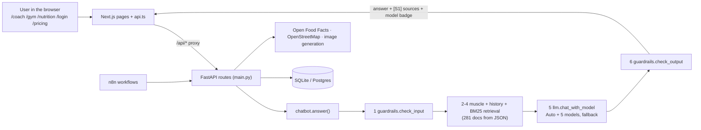

# GymBuddy AI, explained

Generated with the Understand-Anything knowledge-graph format (`.ua/knowledge-graph.json`): 113 nodes, 208 relations, 9 layers, a 13-step tour. Read it top to bottom before the presentation; each step names the files to open.

## The big picture

## The layers

- **Platform UI (Next.js)** (15 items): Pages and components the user clicks.
- **API client & config** (4 items): Typed calls to the backend and the /api proxy.
- **HTTP API (FastAPI)** (32 items): Routes, validation and auth.
- **Chatbot core** (29 items): Guardrails, retrieval, LLM, nutrition maths.
- **Data & knowledge base** (11 items): Database tables and the curated JSON knowledge base.
- **Tests & evaluation** (5 items): pytest suites and the 16-question evaluation.
- **External services & deployment** (6 items): Hosting, AI models and public data APIs.
- **n8n automation** (3 items): Scheduled and chat workflows that call the API.
- **Documentation** (8 items): Report, guides and decisions.

## Guided tour

### 1. The problem and the product

Gym beginners piece advice together from videos, forums and several apps; generic chatbots ignore their body, equipment, diet and injuries. GymBuddy AI is one web platform built around a coach chatbot that knows your profile. Start with the README and the project context.

- **README.md** — `README.md`: How to install, run and test the project.
- **PROJECT_CONTEXT.md** — `PROJECT_CONTEXT.md`: Single source of truth: scope, decisions T1–T14, API contract and changelog.

### 2. What the user sees

The /coach page is the heart: daily targets on the left, the chat in the middle, the clickable muscle map on the right. Other pages add the in-gym chrono, nutrition and accounts.

- **coach/page.tsx** — `frontend/src/app/coach/page.tsx`: The main AI coach page: profile modal, daily targets, conversation list, chat with model picker, photo upload, barcode scanner, sources and ratings, muscle map and exercise demo modal.
- **MuscleMap.tsx** — `frontend/src/components/MuscleMap.tsx`: Hand-made front/back SVG body: every muscle is a clickable path that highlights and selects the muscle.
- **gym/page.tsx** — `frontend/src/app/gym/page.tsx`: In-gym chrono: 15 workout splits, sets and rest timer, voice cues, "machine busy → swap", "do now" queue, water tracker.
- **nutrition/page.tsx** — `frontend/src/app/nutrition/page.tsx`: Nutrition page: macro targets, AI fridge chef with generated dish image, nearby restaurants (GPS or city), 146 recipes with filters, AI nutritionist chat.

### 3. From the browser to the API

Every call goes through api.ts to /api/*. Next.js forwards it to FastAPI, so the browser never sees an API key and there is no CORS issue.

- **api.ts** — `frontend/src/lib/api.ts`: Typed client for every backend endpoint; all calls go to /api/* which Next.js forwards to FastAPI.
- **next.config.mjs** — `frontend/next.config.mjs`: Next.js config: forwards /api/* to the backend, 120 s proxy timeout.
- **main.py** — `backend/app/main.py`: FastAPI application: every HTTP route of the chatbot API (auth, users, chat, vision, conversations, ratings, feedback, muscles, workouts, nutrition, restaurants, n8n digest, admin stats) plus the signed-token restore used on Vercel.

### 4. One chat message, step by step

POST /api/chat calls chatbot.answer(): (1) input guardrails, (2) detect the muscle, (3) keep the last 10 messages and expand short follow-ups, (4) BM25 retrieval, (5) the LLM writes the answer, (6) output warnings, then sources are attached.

- **POST /api/chat** — `backend/app/main.py` lines 933-964: chat
- **answer** — `backend/app/chatbot.py` lines 191-287: Main pipeline for one chat message (guardrails → retrieval → LLM → checks → sources).

### 5. Quality control: guardrails

check_input stops prompt injection, steroids, starvation diets and off-topic requests before any AI call. check_output adds allergy, injury and medical warnings after it.

- **check_input** — `backend/app/guardrails.py` lines 110-144: Blocks unsafe or off-topic input before the AI.
- **check_output** — `backend/app/guardrails.py` lines 147-184: Adds allergy, injury and medical warnings after the AI.

### 6. Grounding: retrieval over our own knowledge base

281 documents built from the JSON files are ranked with BM25, boosted by the selected muscle, filtered by equipment and allergens. The model must cite them as [S1], [S2]…

- **search** — `backend/app/retrieval.py` lines 220-244: BM25 top-k with muscle boost, equipment and allergen filters.
- **BM25** — `backend/app/retrieval.py` lines 177-198: The ranking class.
- **exercises.json** — `backend/app/data/exercises.json`: 55 exercises with muscles, equipment, sets/reps, GIF and EN/FR steps.
- **RAG + deterministic tools** : Generation strategy: answers are grounded in retrieved documents and cite them; numbers come from code.

### 7. Context management

Each prompt contains the profile, the formula targets, the selected muscle, the last 10 messages and the retrieved documents; older messages drop out to keep prompts small.

- **Context management** : Profile + targets + selected muscle + last 10 messages + retrieved docs go into each prompt; older messages drop out.
- **build_retrieval_query** — `backend/app/chatbot.py` lines 95-101: Expands short follow-ups with the previous question.

### 8. The LLM layer and its fallback

llm.py speaks the OpenAI format to OpenRouter. The user can pick Auto or one of 5 models; on error, 429 or empty answer the next model is tried, and if all fail the offline composer answers from the documents. The UI badge shows who answered.

- **chat_with_model** — `backend/app/llm.py` lines 110-138: Tries each candidate model in order and returns the answer and the model that wrote it.
- **mock_generate** — `backend/app/chatbot.py` lines 132-186: Offline composer: builds an answer from the retrieved documents when no model is reachable.
- **OpenRouter models** : External LLM gateway: Auto router + Gemma 4 31B/26B + Nemotron 3.5 Super VL / Lightning / 3 Ultra, plus Recraft for images.

### 9. Numbers come from code

Calories, protein, carbs, fat and water are computed with Mifflin-St Jeor in nutrition.py, never guessed by the AI.

- **compute_targets** — `backend/app/nutrition.py` lines 37-70: Daily calories, macros and water from the profile.
- **bmr** — `backend/app/nutrition.py` lines 32-34: Mifflin-St Jeor basal metabolic rate.

### 10. Multimodal features

A photo goes to a vision model (machine, plate or barcode); barcodes use Open Food Facts; the fridge chef writes meals and generates a dish picture.

- **identify_equipment** — `backend/app/chatbot.py` lines 472-574: Vision scanner: machine, plate or barcode from a photo.
- **lookup_barcode_yuka** — `backend/app/chatbot.py` lines 359-445: Open Food Facts lookup and health score.
- **fridge_meals** — `backend/app/chatbot.py` lines 290-335: Meals from home ingredients + dish image.

### 11. Data storage

Users, conversations, messages (with rating, flags and latency) and feedback are SQLAlchemy tables; SQLite locally, temporary on Vercel, Postgres via DATABASE_URL.

- **models.py** — `backend/app/models.py`: SQLAlchemy tables: User (profile, plan, password hash), Conversation, Message (rating, flags, latency), Feedback.
- **db.py** — `backend/app/db.py`: Database engine and session (SQLite locally or in /tmp on Vercel, any Postgres through DATABASE_URL).

### 12. Tests and evaluation

32 pytest tests check maths, retrieval and guardrails; the 16-question evaluation measures answer quality (100 % offline, 87.5 % with the live model).

- **test_units.py** — `backend/tests/test_units.py`: Unit tests: nutrition maths, BM25, allergen filter, muscle detection, guardrails.
- **test_api.py** — `backend/tests/test_api.py`: API tests with FastAPI TestClient: endpoints, guardrails, n8n key protection.
- **run_eval.py** — `backend/eval/run_eval.py`: Runs the 16-question evaluation set against the chatbot and writes pass rate and latency (results.json / results_mock.json).

### 13. Deployment and automation

Two Vercel projects host the platform and the API. n8n workflows call the API for daily coaching e-mails, a CRM and a Telegram coach.

- **Vercel: gymbuddy-ai** : Hosts the Next.js platform at https://gymbuddy-ai-phi.vercel.app.
- **Vercel: gymbuddy-api** : Hosts the FastAPI app as a serverless Python function.
- **workflow_daily_coach.json** — `automation/workflow_daily_coach.json`: n8n: daily schedule → /api/automation/daily-digest → LLM writes each coaching message → e-mail.
- **workflow_telegram_coach.json** — `automation/workflow_telegram_coach.json`: n8n Telegram bot: /today /workout /eat /log /report, AI briefs and weekly recap.

## Questions the teacher is likely to ask

| Question | Short answer | Where |
|---|---|---|
| What is your generation strategy? | RAG over our own knowledge base + deterministic tools (calorie formula). The model must cite `[S1]`… | `chatbot.py` `answer()`, `retrieval.py`, `nutrition.py` |
| How do you manage context? | Profile + targets + selected muscle + last 10 messages + retrieved docs in each prompt; older messages drop out. | `chatbot.py`, `HISTORY_WINDOW` in `config.py` |
| How do you control quality? | Guardrails before and after the model, sources, 👍/👎, 16-question evaluation (100 % offline, 87.5 % live), 32 tests. | `guardrails.py`, `eval/`, `tests/` |
| What if the AI is down or rate-limited? | Next model in the fallback chain, then an offline answer from the documents; the badge says which. | `llm.py` `chat_with_model()` |
| Why BM25 and not a vector DB? | ~281 small documents: BM25 is instant, free, deterministic and explainable. Embeddings are future work. | `retrieval.py` |
| Why are calories not computed by the AI? | LLMs make arithmetic mistakes; health numbers must be exact and testable. | `nutrition.py` |
| How is it deployed? | Two Vercel projects; the web app proxies `/api` to the API. | `docs/DEPLOYMENT.md` |
| Main limits? | Temporary SQLite on Vercel, ~50 free AI requests/day, simulated Pro plan. | `docs/REPORT.md` §4.2 |

## Open the interactive graph

The graph lives in `.ua/knowledge-graph.json`. With the Understand-Anything plugin installed in Claude Code, run `/understand-dashboard` in this folder to explore it (layers, search, guided tour).
