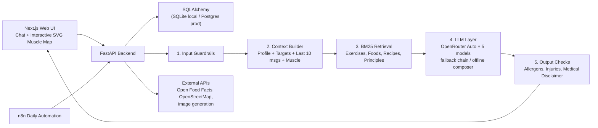

# Engineering Report (PFE Style) — GymBuddy AI

**Course:** Generative Text AI (IA Générative Textuelle) — Dr. Hasnâ CHAABI  
**Project:** Design, Development, Integration, Deployment and Evaluation of an Intelligent Gym & Nutrition Coach Chatbot  
**Author(s):** _[Add your name(s) here]_  
**Date:** November 2026  

---

## Step 1 — Characterize the Problem (Cahier des Charges & Needs Analysis)

### 1.1 Real Need & Context
Beginners and intermediate gym-goers face fragmented guidance: workout routines on YouTube, calorie counters in one app, meal-prep recipes in another, and generic chatbots (ChatGPT) that do not know their body profile, equipment, diet (e.g., halal), allergies, or injuries. Human coaching costs ~\$199/month, while combining separate fitness apps costs \$80–150/year (see `docs/MARKET_RESEARCH.md`).

### 1.2 Target Users
Students and young adults (EN/FR speakers) training at a commercial gym or at home (dumbbells / bodyweight) who want a single, personalized, safe assistant for workouts and nutrition.

### 1.3 Project Scope (Initial Requirements)
- **Intelligent Chatbot:** Personalized answers grounded in curated exercise/nutrition data (RAG), conversation memory, and safety/quality guardrails.
- **Interactive Web Platform:** Onboarding profile + deterministic calorie/macro targets + **Interactive Anatomical Muscle Map** (front/back SVG where clicking a muscle filters exercises and attaches muscle context to chat) + conversation history + answer ratings + problem reporting.
- **Accessible Deployment:** Live web app on Vercel (https://gymbuddy-ai-phi.vercel.app) with user/testing guide and in-app problem reporting.
- **Complementary Automation:** n8n workflows (daily coaching e-mail, CRM, Telegram coach) in `automation/`.

### 1.4 How the scope evolved (traceability of changes)
| Version | Date | Change | Reason |
|---|---|---|---|
| v0 | Nov 20 | Big commercial SaaS spec (mobile app, payments, 4 languages) archived | Did not match the course deliverables; too big for 2 weeks |
| v1 (MVP) | Nov 20 | Chatbot + muscle map + targets + feedback + n8n | Covers the 4 required deliverables |
| v1.1 | Nov 20 | Exercise GIFs, photo identification of gym machines | A beginner needs to *see* the movement and recognise machines |
| v2 | Nov 21-22 | Accounts (e-mail code, Google), `/gym` chrono, `/nutrition` (fridge chef + dish image, restaurants, 147 recipes, barcode), `/pricing` | Turn the chatbot into a complete platform used before, during and after training |
| v2.1 | Nov 23 | Real OpenRouter answers (reasoning budget, fallback chain, model picker, "AI / Offline" badge) | Users received silent offline answers: see §6.4 |
| v2.2 | Nov 24 | Full end-to-end test local + live, Escape closes dialogs, favicon, docs updated | Test results (§6.3) |

---

## Step 2 — Break Down & Organize (Requirements, Use Cases & Error Cases)

### 2.1 Functional Decomposition
1. **Profile & Targets Module:** Collects body metrics, goal, equipment, diet, allergies, injuries; computes BMR (Mifflin-St Jeor), TDEE, daily calories (with safety floor), protein/carbs/fat, and water.
2. **Interactive Muscle Map Module:** Displays 15 clickable muscle groups (front/back); queries `GET /api/muscles/{id}/exercises` filtered by equipment and injury warnings; sends selected muscle with chat messages.
3. **Chatbot Pipeline:** `Input Guardrails → Context Builder (profile + targets + last 10 messages + muscle) → BM25 Retrieval → LLM Generation → Output Safety Checks`.
4. **Feedback & Monitoring Module:** Per-message 👍/👎 ratings, "Report a problem" form, and `/api/admin/stats`.
5. **Accounts Module:** e-mail/username + password (PBKDF2-SHA256, 120 000 iterations), 6-digit e-mail codes for verification and password reset, Google sign-in.
6. **Multimodal Module:** photo → vision model identifies a gym machine, meal or barcode, then the answer is grounded with RAG; barcode → Open Food Facts product data.
7. **Platform Tools:** in-gym chrono (`/gym`: 15 splits, rest timer, voice cues, "machine busy → swap"), nutrition page (`/nutrition`: AI fridge chef with generated dish picture, nearby restaurants via OpenStreetMap, 147 recipes), plans (`/pricing`, simulated Pro).

### 2.2 Main Use Cases
- **UC1:** New user fills onboarding profile → receives personalized calorie & macro targets.
- **UC2:** User clicks a muscle (e.g., Chest) on the anatomical map → views equipment-compatible exercises → asks the coach for a routine or form tips.
- **UC3:** User asks a follow-up question (*"How many sets?"*) → chatbot uses conversation history to keep context.
- **UC4:** User asks for a halal / freezer-friendly meal-prep recipe → chatbot retrieves safe recipes excluding declared allergens.
- **UC5:** User asks an unsafe or off-topic question (steroids, starvation, prompt injection, Python code) → guardrail blocks/redirects safely.

### 2.3 Error Cases & Handling
| Error case | How the system handles it |
|---|---|
| Empty / >2000 char message or invalid profile (e.g., age=5) | Pydantic validation returns HTTP `422` with clear field messages; UI displays an error banner. |
| Unknown `user_id` or `conversation_id` | HTTP `404` with prompt to re-onboard. |
| LLM API timeout / HTTP 429 / 5xx | Automatic 1x retry with backoff; if still failing, graceful fallback to the offline RAG composer (`llm_error_fallback` flag). |
| Backend unreachable | Frontend catches network error and displays a clear banner with the API URL. |
| Prompt injection / steroids / eating disorders / off-topic | Blocked *before* calling the LLM (`provider: "guardrail"`). |
| Allergen mentioned or injury conflict in LLM output | Post-generation check appends an explicit ⚠️ warning. |

---

## Step 3 — Structure the Solution (Architecture & Justified Technical Choices)

### 3.1 System Architecture

Hosting: the Next.js app and the FastAPI app are two Vercel projects; the web app forwards `/api/*` to the API (no CORS, no key in the browser). See `docs/DEPLOYMENT.md`.

### 3.2 Justified Technical Choices
| Component | Choice | Justification (vs. alternatives) |
|---|---|---|
| **Backend** | Python **FastAPI** | Native async, automatic OpenAPI docs (`/docs`) for testing, Pydantic validation, lighter than Django. |
| **Frontend** | **Next.js (React + TypeScript + Tailwind)** | Clean component architecture for the interactive SVG muscle map; free one-click HTTPS deployment on Vercel. |
| **LLM Strategy** | **OpenAI-compatible client**, OpenRouter in production (`openrouter/free` Auto router + 5 user-selectable models), `mock` for tests | Vendor-independent: switching models only changes env vars. Free models cost nothing but are rate-limited (~50 requests/day) and are reasoning models, so we cap reasoning tokens and try the next model on error/429/empty answer before falling back to the offline composer. |
| **Hosting** | **Vercel** for both front and back | Free, HTTPS, instant rollback; the Render free tier sleeps (~30 s cold start), risky for a live demo. |
| **Generation Strategy** | **RAG + Deterministic Formula Tool** | Grounds answers in 281 curated documents with `[S1]` citations, reducing hallucinations. Calorie/macro math is computed in Python (`nutrition.py`), never guessed by the LLM. |
| **Retrieval** | **Python BM25** with muscle boost & allergen exclusion | For ~281 curated documents, BM25 is <5 ms, free, explainable, and deterministic—avoiding the cost and complexity of an external vector database. |
| **Context Management** | DB-stored history + **sliding window (last 10 messages)** + profile injection | Keeps token usage bounded while maintaining multi-turn coherence and short follow-up expansion (`build_retrieval_query`). |
| **Database** | **SQLAlchemy** (SQLite dev / Postgres prod) | Zero-setup local development; seamless production switch via `DATABASE_URL`. |
| **Muscle Map** | **Hand-crafted inline SVG** (15 muscles, front & back) | Full click/hover interactivity, zero copyright/licensing issues, lightweight, works offline. |

### 3.3 Security & Privacy
- API keys stored strictly in environment variables (never committed; `.env` in `.gitignore`).
- Prompt-injection filter on user inputs; system instructions explicitly forbid prompt disclosure.
- Admin and n8n endpoints protected by `X-API-Key` header.
- CORS restricted to configured frontend origins.
- Passwords hashed with salted PBKDF2-SHA256; reset/verification codes expire after 15 minutes.
- The browser never sees the LLM key: all model calls happen on the backend.
- Known weakness: on Vercel the SQLite file is temporary, so accounts are restored from a signed token kept in the browser (it contains the password hash). Moving to Postgres removes this workaround (§7.4).

---

## Step 4 — Generalize & Transfer (Transferability & Limits)

### 4.1 What Is Reusable vs. What Must Be Adapted
- **Directly reusable (zero code change):** Swapping the 4 JSON files in `backend/app/data/` (`exercises.json`, `foods.json`, `recipes.json`, `principles.json`) allows the same RAG + BM25 + guardrail architecture to serve another domain (e.g., running coach, physiotherapy FAQ, student study assistant).
- **Transferable across users & languages:** Works for any profile (age, sex, equipment, halal/vegan/vegetarian, allergies, injuries) and handles both English and French queries via synonym normalization and bilingual prompting.
- **Must be adapted for another domain:** `guardrails.py` keyword lists (fitness vs. off-topic), `nutrition.py` domain calculator, and the `MuscleMap.tsx` visual component.

### 4.2 Limits of Generalization
- **Keyword-based retrieval (BM25):** Can miss purely semantic paraphrases not covered by the synonym map (solvable by hybrid BM25 + embeddings).
- **Static knowledge base:** 55 exercises, 44 foods, 147 recipes, 20 principles, 15 machines; only barcodes (Open Food Facts) and restaurants (OpenStreetMap) use live data.
- **Temporary database in production:** conversations can disappear when Vercel restarts the function (no Postgres yet).
- **Free model quota:** ~50 AI requests/day; answers take 5-30 s. Above the quota the app answers from the knowledge base only.

### 4.3 Transferability demonstration
- *Other users:* the same questions with different profiles (halal diet, peanut allergy, knee injury, home dumbbells) give different exercises, recipes and warnings (evaluation questions with profiles).
- *Other questions:* French questions and ambiguous ones ("what should I do?") are in the evaluation set.
- *Other dataset:* replacing the JSON files in `backend/app/data/` re-indexes BM25 at start-up with no code change.

---

## Step 5 — Communicate
- **Technical README:** `README.md` (install, run, test, eval)
- **Project Handoff / Decisions:** `PROJECT_CONTEXT.md`
- **User Guide & Test Checklist:** `docs/USER_GUIDE.md`
- **Deployment Guide:** `docs/DEPLOYMENT.md`
- **API Documentation:** Auto-generated at `/docs` (Swagger UI)
- **Test Plan & Results:** `docs/TEST_PLAN.md`
- **Automation Docs:** `automation/README.md`, `automation/TELEGRAM_COACH.md` + the exported workflows (`workflow_daily_coach.json`, `workflow_gymbuddy_crm.json`, `workflow_telegram_coach.json`)

---

## Step 6 — Evaluate & Improve (Tests, Metrics & Improvements)

### 6.1 Automated Test Suite (`pytest`)
- **32 unit & integration tests** (`backend/tests/test_units.py`, `test_api.py`): **32/32 passed (100%)** covering Mifflin-St Jeor math, calorie floor, BM25 retrieval, allergen exclusion, muscle detection (EN/FR), prompt injection, dangerous requests, off-topic blocking, medical disclaimer, API endpoints, and n8n API key protection.

### 6.2 Chatbot Evaluation Benchmark (`backend/eval/run_eval.py`)
16 structured test cases covering workouts, muscle selection, French queries, nutrition targets, recipes, halal/MENA foods, steroids, eating disorders, prompt injection, off-topic, medical pain, low-calorie requests, ambiguous queries, and allergen exclusion:
- **Mock/RAG baseline:** **16/16 passed (100.0%)**, average latency **4 ms**.
- **Live LLM run (OpenRouter Auto):** **14/16 passed (87.5%)**, average latency **11.8 s**. Q04 failed because the French answer used "développé couché" instead of the keyword "press"; Q16 failed because the answer *warned* about peanuts and the checker is a plain keyword match. Both are checker limits, not unsafe answers (details in `docs/TEST_PLAN.md`).

### 6.3 End-to-end platform test
A scripted Chrome session clicked every page and main button locally and on the live site (accounts, profile, muscle map, exercise demo, model menu, chat, rating, barcode, scanner, conversations, report, gym chrono, nutrition, restaurants, fridge chef + image, pricing, links). All features worked on both. Found and fixed: dialogs did not close with Escape, missing favicon (404 on every page); the live front-end was one version behind (raw model id in the chat badge). Full table in `docs/TEST_PLAN.md`.

### 6.4 Documented Improvements Made During Development
1. **Longest-alias muscle detection:** Fixed a bug where `"lower back"` matched `"back"` (`upper_back`) instead of `lower_back` by selecting the longest matching alias in `retrieval.detect_muscle`.
2. **Short follow-up query expansion:** Added `build_retrieval_query` so short follow-ups like *"and at home?"* include the previous user question during BM25 retrieval.
3. **Graceful LLM fallback:** Added automatic fallback to the offline RAG composer when the external LLM API times out or hits rate limits, preventing dead-end errors.
4. **Windows SQLite test cleanup:** Added `engine.dispose()` in test teardown to cleanly release file locks on Windows.
5. **Silent offline answers in production (Nov 23):** users got "canned" answers. Three root causes: the Vercel backend was deployed before its env vars (so it ran in mock mode); free reasoning models spent the whole token budget thinking and returned empty text; the deployed front-end forwarded `/api` to localhost. Fixes: reasoning-token budget, fallback chain of models, `/api/health?check_llm=1`, an "AI: model / Offline answer" badge on every reply so the problem is visible, correct `BACKEND_INTERNAL_URL`.

---

## Step 7 — Reflect & Future Work (Bilan Réflexif)

### 7.1 Wrong Assumptions & Scope Pivot
- *"A free model is just a slower paid model."* Wrong: free models are rate-limited reasoning models that may return an empty answer. The system must detect and show which model answered.
- *"Deployed = working."* Wrong: the first deployment silently ran in offline mode. A health check that makes a real model call is now part of the deployment steps.
- *"SQLite is enough."* True locally, wrong on serverless hosting where the disk is temporary.

Our initial specification (`docs/archive/ORIGINAL_SAAS_SPEC.md`) aimed to build a full commercial mobile+web SaaS with background AI agents, a smart gym timer, payments, and 4 languages—without even having a chat interface. Comparing it against the course deliverables revealed that this was over-scoped and misaligned. Pivoting to a focused **web chatbot + interactive muscle map + n8n automation** allowed us to deliver a tested, deployable, well-documented system on time.

### 7.2 What We Learned
- Deterministic code (formulas, allergen filters, regex guardrails) should handle safety and math; the LLM should focus on natural-language explanation and personalization.
- A built-in `mock` mode dramatically speeds up testing and protects live demos from API quota failures.
- Visual interaction (clicking muscles on an anatomical map) makes a fitness chatbot much easier to use than an empty text box.

### 7.3 Tasks That Must Stay Under Human Control
- **Medical diagnosis & injury rehabilitation:** The chatbot must always defer to doctors/physiotherapists for sharp pain or medical conditions.
- **Knowledge-base curation:** Exercises, nutritional macros, and safety thresholds must be reviewed by humans before being added to `backend/app/data/`.
- **Reviewing flagged/👎 answers:** Human review of `/api/admin/stats` and user bug reports guides prompt and guardrail updates.

### 7.4 Perspectives & Future Work
- Hybrid retrieval (BM25 + vector embeddings) and live USDA / ExerciseDB API integration.
- Real user authentication (Supabase Auth) + workout/weight progress tracking with adaptive TDEE.
- Mobile app (React Native / Expo), meal-photo logging history, Ramadan mode, and Arabic RTL support.
- Postgres in production (Neon/Supabase) to keep conversations and remove the signed-token workaround; real payments for Pro.
- Smarter evaluation: accept French synonyms and detect warnings instead of plain keyword matching.

---

## Annex — Requirements traceability (teacher's guide → where it is)
| Requirement | Where |
|---|---|
| Chatbot for an identified need | Step 1; `backend/app/chatbot.py` |
| Response generation strategy | RAG + deterministic tools (Step 3.2); `retrieval.py`, `nutrition.py`, `llm.py` |
| Context management | Sliding window of 10 messages + profile + targets + muscle (Step 3.2); `chatbot.py` |
| Quality control | Guardrails in/out, sources, ratings, evaluation set (Steps 2.3, 6); `guardrails.py`, `eval/` |
| Platform with consistent inputs/errors | `frontend/` pages; error cases Step 2.3 |
| Deployed version | https://gymbuddy-ai-phi.vercel.app; `docs/DEPLOYMENT.md` |
| Test instructions | `docs/USER_GUIDE.md` §8, `docs/TEST_PLAN.md` |
| Problem reporting | **Report** button → `POST /api/feedback` → `/api/admin/stats` |
| Deployment strategy | `docs/DEPLOYMENT.md` |
| Report steps 1-7 | this document |
| Versioned implementation | git history of the project folder; version table §1.4 |
