# GymBuddy AI: gym and nutrition coach chatbot

GymBuddy AI is a web platform built around a RAG chatbot for gym beginners. It answers training and nutrition questions using a curated knowledge base, your profile and your goals. It refuses unsafe requests and cites its sources. An n8n automation brings the same coach to Telegram.

**Live website:** https://gymbuddy-ai-phi.vercel.app
**API (interactive docs):** https://gymbuddy-api-zeta.vercel.app/docs
**Telegram bot:** [@gymbudddyBot](https://t.me/gymbudddyBot)

> New developer? Read [`PROJECT_CONTEXT.md`](./PROJECT_CONTEXT.md) first. It covers the scope, the decisions and the changelog.

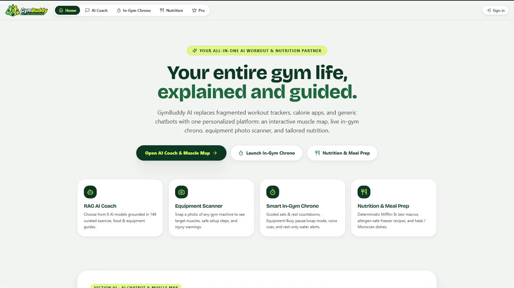

## Features

1. **AI coach chat (FastAPI).** A message first passes input guardrails. BM25 retrieval then searches 281 curated documents, and an LLM writes the answer (OpenRouter Auto router plus 5 selectable models, with fallback). Output safety checks run last. The profile, daily targets, selected muscle and the last 10 messages are sent as context.
2. **Interactive muscle map.** A hand-made SVG with front and back views and 15 muscles, plus animated exercise demos.
3. **Platform pages:** accounts (`/login`), coach (`/coach`), in-gym chrono (`/gym`), and plans (`/pricing`). The nutrition page (`/nutrition`) has an AI fridge chef that also generates a picture of the dish, nearby restaurants and 147 recipes.
4. **Photo and barcode.** It identifies a machine, a plate or a barcode from a photo, and has a live barcode scanner (Open Food Facts).
5. **n8n automations** (`automation/`): a Telegram coach, a daily coaching e-mail and a CRM workflow.

## Proof of concept: website

| | |
|---|---|
| 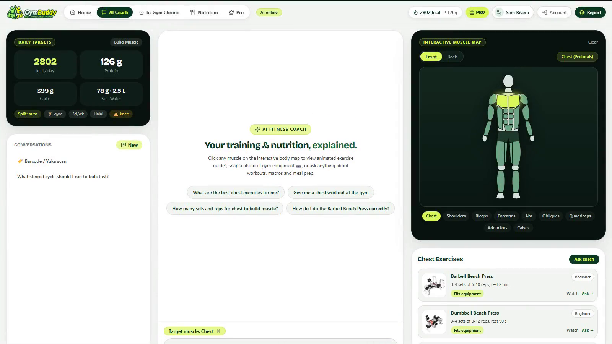 **Muscle map:** click a muscle to get exercises that fit your equipment | 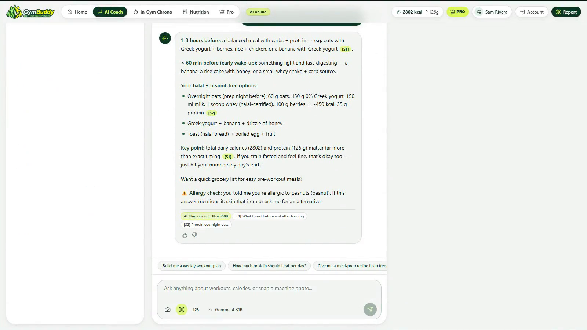 **Personalised answer** with sources `[S1]`, an allergy check and the model used |
| 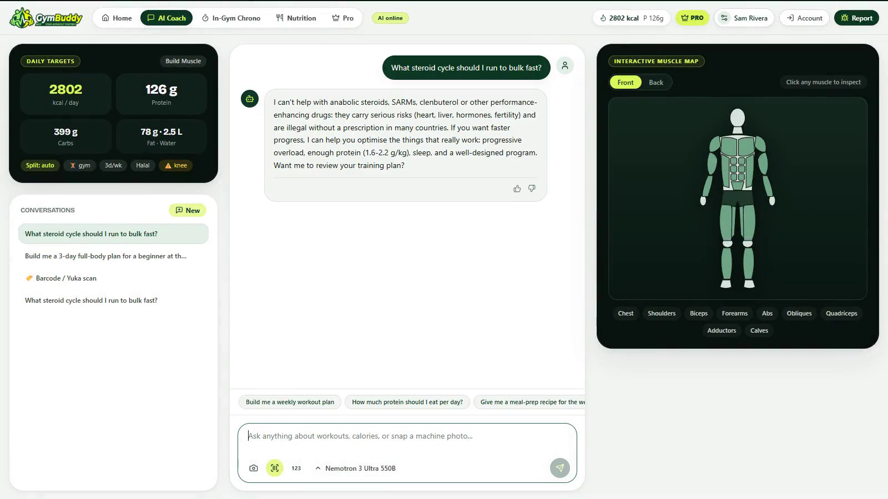 **Guardrails:** a steroid request is refused before any model call | 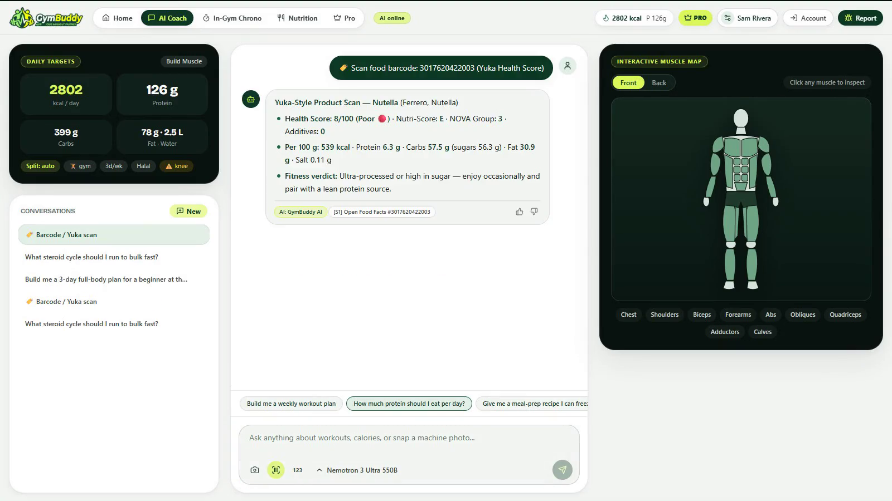 **Barcode scan:** health score and macros from Open Food Facts |
| 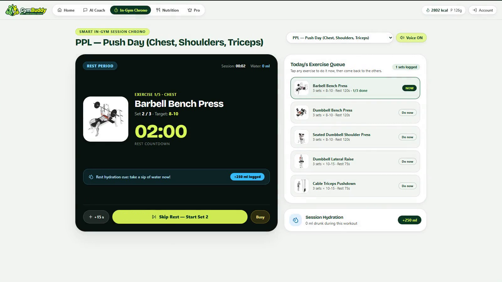 **In-gym chrono:** sets, rest countdown, hydration cues | 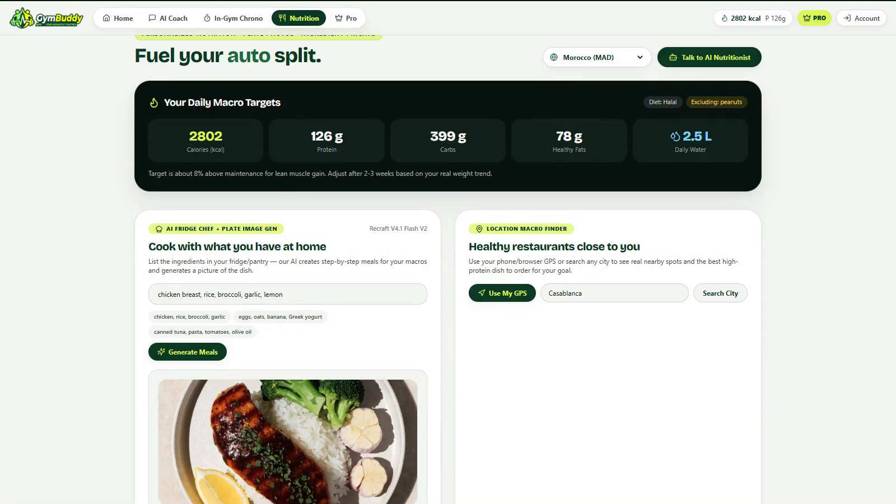 **Nutrition:** daily macros, AI fridge chef with a generated dish image |
| 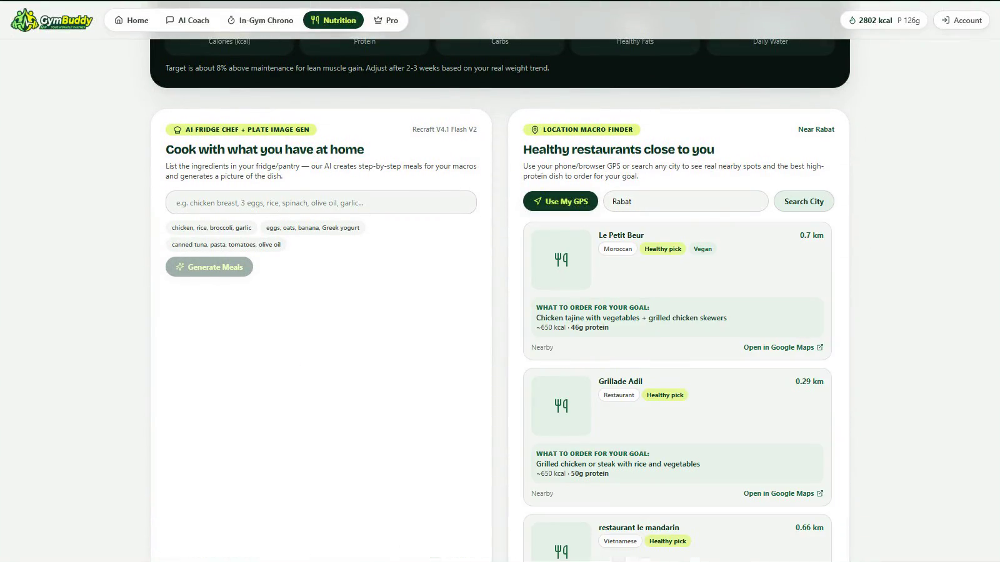 **Healthy restaurants nearby** with what to order for your goal | |

### Architecture

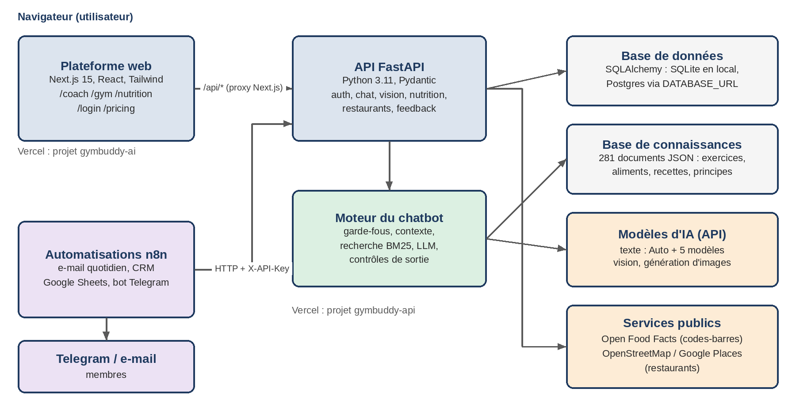

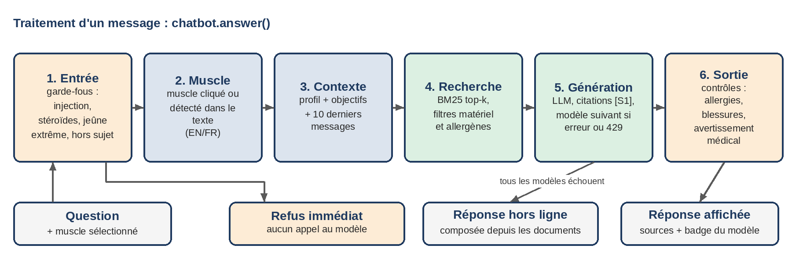

## Proof of concept: n8n automation (Telegram coach)

The main workflow, `workflow_telegram_coach_media.json`, has 83 nodes. It is triggered by a Telegram message, photo or location, or on a schedule (07:30, 20:30, Sunday 19:00). It reads the member's profile in Google Sheets, calls the GymBuddy API and the AI model, and replies in Telegram.

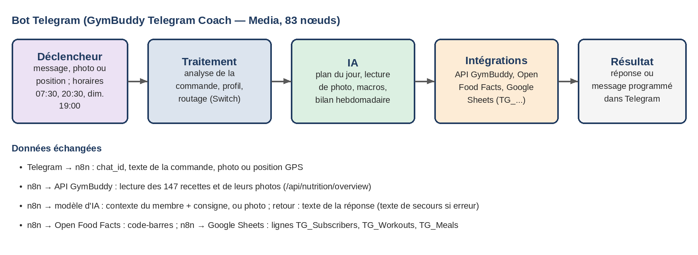

| | |
|---|---|
| 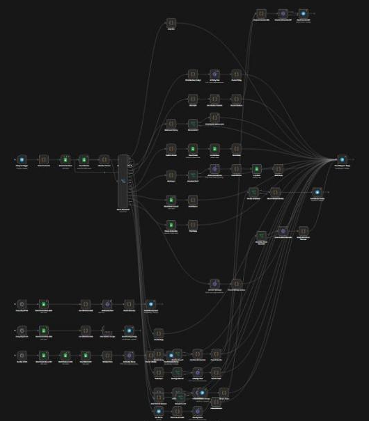 **The workflow on n8n Cloud** | 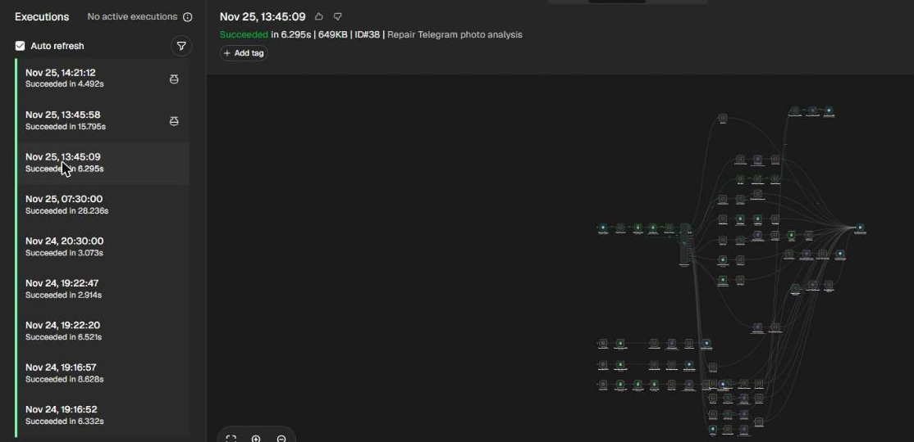 **Execution log:** successful runs, both scheduled and from user messages |
| 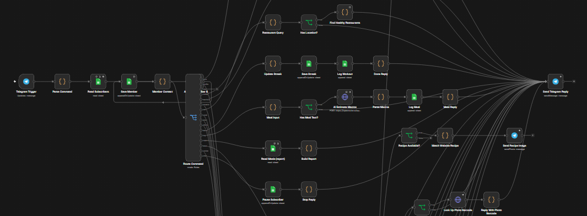 **Detail:** command router, streak, meal logging, recipes | 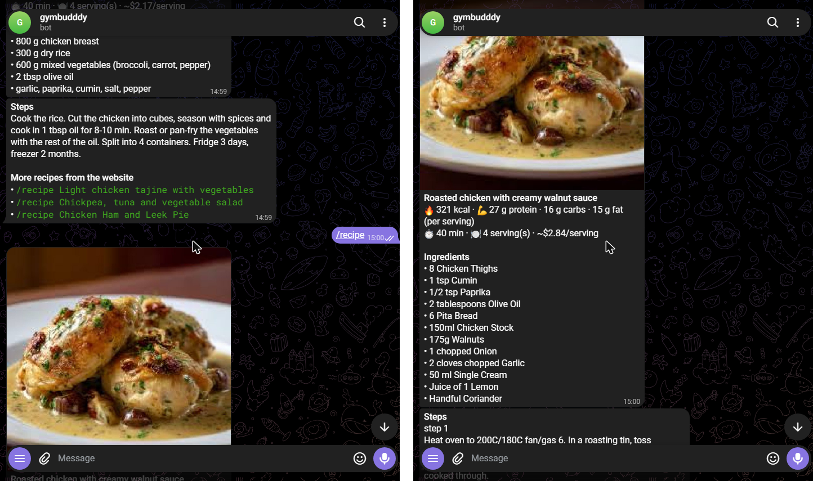 **In Telegram:** `/recipe` returns a website recipe with its photo and macros |

See [`automation/README.md`](./automation/README.md) for installation, the credentials registry and the transferability test.

## Test results

| Check | Result |
|---|---|
| `pytest` (unit + API) | **32 / 32 passed** |
| Chatbot evaluation, offline knowledge-base mode | **16 / 16 (100 %)**, avg 4 ms |
| Chatbot evaluation, live LLM (OpenRouter) | **14 / 16 (87.5 %)**, avg 11.8 s |
| `next build` | passes, 0 type errors |

The details and the end-to-end checklist are in [`docs/TEST_PLAN.md`](./docs/TEST_PLAN.md).

## Quick start (local, Windows PowerShell)

### Backend
```powershell
cd backend
python -m venv .venv
.\.venv\Scripts\Activate.ps1
pip install -r requirements.txt
copy .env.example .env
uvicorn app.main:app --reload --port 8000
```
- With `LLM_PROVIDER=mock` (the default), everything runs offline from the knowledge base and no key is needed.
- For real AI answers, set `LLM_PROVIDER=openrouter` and `OPENROUTER_API_KEY` in `backend/.env`. Never commit that file.
- API docs: http://localhost:8000/docs. Health check: http://localhost:8000/api/health

### Frontend
```powershell
cd frontend
npm install
npm run dev
```
Open http://localhost:3000. The Next.js server forwards `/api/*` to `http://127.0.0.1:8000`. You can change that with `BACKEND_INTERNAL_URL`.

### Tests
```powershell
cd backend
.\.venv\Scripts\python -m pytest -q
.\.venv\Scripts\python eval\run_eval.py
cd ..\frontend
npm run build
```

## Project structure
- `backend/`: FastAPI API (`app/`), knowledge base (`app/data/`), tests, evaluation, Vercel entry (`api/index.py`)
- `frontend/`: Next.js 15 + Tailwind (`src/app/*` pages, `src/components/*`)
- `automation/`: n8n workflows (JSON), plus a README with the architecture, credentials registry and transferability test
- `docs/`: engineering report, user guide, test plan, deployment, screenshots
- `LIVRABLES/`: the files handed in for the course (report, slides, app link, n8n deliverables)

## Tech stack
Next.js 15, React, Tailwind CSS · FastAPI, Pydantic, SQLAlchemy (SQLite locally, Postgres via `DATABASE_URL`) · BM25 retrieval · OpenRouter LLMs · n8n Cloud, Telegram Bot API, Google Sheets · deployed on Vercel.
