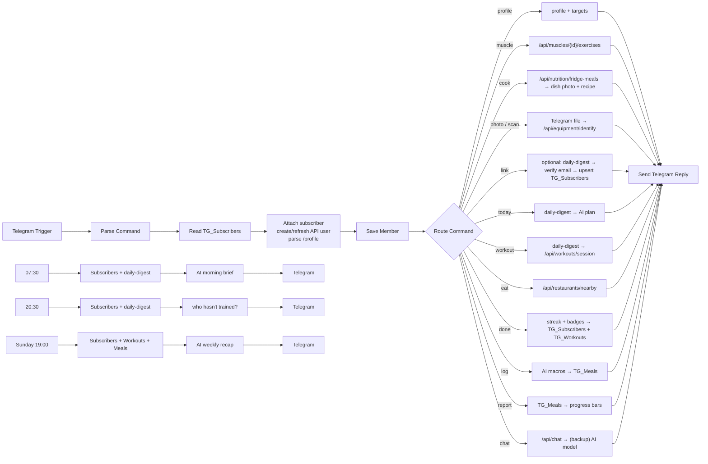

# GymBuddy AI — Telegram Coach (n8n workflow #3)

File: [`workflow_telegram_coach.json`](./workflow_telegram_coach.json) · 88 nodes · only built-in n8n nodes (no community plugins).

A Telegram bot that works as a pocket gym coach for **anyone**: no GymBuddy website account is needed. Each Telegram user sets a profile in the chat (`/profile`), the bot creates a GymBuddy API user from it, and then uses the same features as the website (targets, AI chatbot, workouts, muscle exercises, restaurants, photo scanner, barcode, AI fridge chef with a dish picture). It answers commands, logs workouts and meals in Google Sheets, and sends messages on its own every day.

## Where it comes from (credits)
We looked at the community templates on n8n.io and built on two free ones:

| Template | Author | What we took |
|---|---|---|
| [#7756 Nutrition tracker & meal logger with Telegram, Gemini AI and Google Sheets](https://n8n.io/workflows/7756-nutrition-tracker-and-meal-logger-with-telegram-gemini-ai-and-google-sheets/) | John Alejandro Silva | Meal logging with AI macro estimates, Google Sheets as the database, the daily "report" with progress bars |
| [#16969 Coach fitness and nutrition on Telegram with Claude, Google Sheets and Calendar](https://n8n.io/workflows/16969-coach-fitness-and-nutrition-on-telegram-with-claude-google-sheets-and-calendar) | Dr. Firas | Telegram coach that keeps a profile and a workout history in Sheets |

Also reviewed: [#6697 Telegram fitness bot (workout plans from photo/text)](https://n8n.io/workflows/6697-telegram-fitness-bot-custom-workout-plans-from-phototext-using-gemini-ai/) by Parth Pansuriya (paid). Its page suggests "daily workout reminders and streak tracking via Cron and Telegram" as an extension, which is exactly what we added.

**What is new in our version:** none of these templates send messages on a schedule or know the user's real training plan. Ours is connected to the GymBuddy app (targets, today's split, exercise list with GIF demos, nearby healthy restaurants, the app's RAG chatbot), and adds a streak system with badges, an evening "you haven't trained yet" nudge and an AI weekly recap.

## What the bot does

| Message | What happens | GymBuddy API used |
|---|---|---|
| `/start`, `/help` | Welcome + list of commands | – |
| *(first message)* | The Telegram user is registered automatically in `TG_Subscribers` and a GymBuddy API user is created with default values | `POST /api/users` |
| `/profile 22 male 175cm 72kg muscle gym 3 days halal allergy peanuts injury knee` | Any order, EN or FR (`femme`, `perte de poids`, `haltères`, `4 jours`…). Saves the profile, computes the daily targets with the app's formula. `/profile` alone shows it | `POST /api/users` |
| `/muscle chest` | Best exercises for one muscle with GIF demos and injury warnings (the website's muscle map) | `GET /api/muscles/{id}/exercises` |
| `/cook chicken, rice, broccoli` | AI fridge chef: 2 recipes for the member's macros + an AI-generated photo of the dish | `POST /api/nutrition/fridge-meals` |
| 📷 photo (machine, plate or barcode) | Vision AI identifies it: machine + exercises, plate + estimated macros, or product score | `POST /api/equipment/identify` |
| `/scan 3017620422003` or just the number | Product nutrition and health score (Open Food Facts) | `POST /api/equipment/identify` |
| `/link you@email.com` | **Optional**: reuse the profile of a website account that has daily coaching turned on | `GET /api/automation/daily-digest` |
| `/today` | AI writes today's plan: session focus, a meal idea, motivation | daily-digest + AI model |
| `/workout` (or `/workout legs`) | Exercise list for today's split: sets × reps, rest, GIF demo link, injury warnings, link to the in-gym chrono | `GET /api/workouts/session` |
| 📍 location, or `/eat Rabat` | Up to 4 nearby restaurants with the healthy dish to order, kcal/protein, ✅ if it fits the member's per-meal budget, Maps link | `POST /api/restaurants/nearby` |
| `/done` (or `/done legs`) | Logs the workout, updates the 🔥 streak (up to 2 rest days in a row keep it alive), unlocks badges at 3/7/14/30/50 | – |
| `/log chicken tajine and bread` | AI estimates kcal/protein/carbs/fat and gives a tip, row added to `TG_Meals` | AI model |
| `/report` | Today's calories and protein vs targets with progress bars, and what to eat to close the protein gap | – |
| `/stop` | Pauses the scheduled messages (`/start` turns them back on) | – |
| Any other text | Answered by the app's own chatbot (knowledge base + sources). If the app can't answer, the AI model answers directly | `POST /api/chat` |

Scheduled messages (time zone `Africa/Casablanca`, change it in *Workflow settings*):
- **07:30 every day:** AI morning brief per member (session, targets, breakfast idea, streak).
- **20:30 every day:** nudge only for members whose plan says they train today and who haven't sent `/done`. No AI call.
- **Sunday 19:00:** AI weekly recap from the logged workouts and meals (workouts this week, average kcal/protein vs target, one thing to improve, one mini-challenge).

## Architecture



Every HTTP and Sheets node continues on error, and every AI message has a written fallback, so a member always gets an answer even if the AI model or the API is down.

## Setup (about 15 minutes)

1. **Create the bot:** in Telegram open `@BotFather` → `/newbot` → copy the token. Optional: `/setcommands` and paste
   ```
   profile - My profile and daily targets
   today - Today's plan
   workout - Exercise list for today
   muscle - Best exercises for a muscle
   cook - Recipe from my ingredients + dish photo
   scan - Product nutrition from a barcode
   eat - Healthy food near me
   done - Log a finished workout
   log - Log a meal
   report - Today's nutrition
   help - All commands
   ```
2. **Google Sheet:** in the same spreadsheet as the CRM (`CRM_GOOGLE_SHEET_ID`), add 3 tabs named exactly `TG_Subscribers`, `TG_Workouts`, `TG_Meals`, and import the header row from [`tg_subscribers.csv`](./tg_subscribers.csv), [`tg_workouts.csv`](./tg_workouts.csv), [`tg_meals.csv`](./tg_meals.csv).
3. **n8n needs a public HTTPS URL** for the Telegram Trigger. Use n8n Cloud, or locally `npx n8n start --tunnel`, or ngrok with `WEBHOOK_URL=https://<your-ngrok>.ngrok-free.app/`.
4. **Environment variables** (same as the CRM workflow):

   | Name | Value |
   |---|---|
   | `GYMBUDDY_API_URL` | `https://gymbuddy-api-zeta.vercel.app` (default) |
   | `GYMBUDDY_API_KEY` | same value as the backend's `AUTOMATION_API_KEY` |
   | `LLM_ENDPOINT` | `https://openrouter.ai/api/v1/chat/completions` (default) or any OpenAI-compatible endpoint |
   | `LLM_MODEL` | `openrouter/free` (default) |
   | `LLM_API_KEY` | your OpenRouter key |
   | `LLM_MAX_TOKENS` | optional, default 1500 (free models are reasoning models and need room) |
   | `CRM_GOOGLE_SHEET_ID` | the spreadsheet ID |
   | `N8N_BLOCK_ENV_ACCESS_IN_NODE` | `false` (the workflow reads the variables above with `$env`) |

   `automation/start-n8n.ps1` sets all of these from `backend/.env`; only `CRM_GOOGLE_SHEET_ID` must be set by hand.

5. **Import:** n8n → *Workflows → Import from File* → `workflow_telegram_coach.json`.
6. **Credentials:** create a *Telegram API* credential named `GymBuddy Telegram Bot` (paste the token) and select it on the 7 Telegram nodes (Trigger, Send Telegram Reply, Send Dish Photo, Get Photo, Send Morning Brief, Send Evening Nudge, Send Weekly Recap). Select your `GymBuddy Google Sheets` credential on the 13 Google Sheets nodes.
7. **Activate** the workflow (the toggle top right). Telegram only delivers messages to an active workflow (or while you click *Test workflow*).
8. **Test:** from any Telegram account (no website account needed) send the bot `/start`, `/profile 22 male 175cm 72kg muscle gym 3 days`, `/today`, `/muscle chest`, `/cook chicken, rice, broccoli`, a photo of your plate, `3017620422003`, `/workout`, your location, `/done`, `/log 2 eggs and toast`, `/report`. To test the schedules without waiting, open *Every Day 07:30* and click *Execute step*.

## Credentials registry (added by this workflow)

| Name | Type | Service | Permissions | How to recreate |
|---|---|---|---|---|
| `GymBuddy Telegram Bot` | n8n credential `telegramApi` | Telegram Bot API | Read messages sent to the bot, send messages | `@BotFather` → `/newbot` → token → n8n *Credentials → New → Telegram API* |
| `GymBuddy Google Sheets` | n8n credential `googleSheetsOAuth2Api` | Google Sheets | Read/write the 3 `TG_` tabs | Same credential as the CRM workflow |

## Limits to say in the presentation
- The free AI tier allows about 50 requests per day: each member costs 1 request in the morning, 1 per `/today`, `/log` or backup answer, 1 on Sunday. The evening nudge and `/workout`, `/eat`, `/done`, `/report` use no AI.
- On Vercel the API database resets on cold start. The bot keeps each profile in `TG_Subscribers` (`profile_json`) and recreates the API user automatically, so members never notice.
- `/cook` and photos use the AI too (fridge chef = 1 text + 1 image request, photo = 1 vision request).
- Restaurant results come from OpenStreetMap; small towns can return nothing, and the bot then sends generic healthy picks.
- Tested on 24 Nov 2026: every Code node was run against the real GymBuddy API (profile, stale user recreation, workout, muscle, barcode, restaurants, streak, chatbot, scheduled members, fridge chef + image, photo recognition). The Telegram and Google Sheets nodes still need a real run with your credentials.
