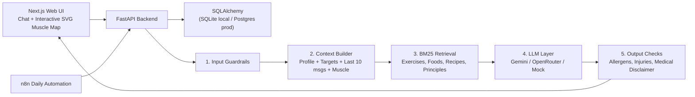

# Engineering Report (PFE Style) — GymBuddy AI

**Course:** Generative Text AI (IA Générative Textuelle) — Dr. Hasnâ CHAABI  
**Project:** Design, Development, Integration, Deployment and Evaluation of an Intelligent Gym & Nutrition Coach Chatbot  
**Author(s):** _[Add your name(s) here]_  
**Date:** November 2026  

---

## Step 1 — Characterize the Problem (Cahier des Charges & Needs Analysis)

### 1.1 Real Need & Context
Beginners and intermediate gym-goers face fragmented guidance: workout routines on YouTube, calorie counters in one app, meal-prep recipes in another, and generic chatbots (ChatGPT) that do not know their body profile, equipment, diet (e.g., halal), allergies, or injuries. Human coaching costs ~\$199/month, while combining separate fitness apps costs \$80–150/year (see `docs/MARKET_RESEARCH.md`).

### 1.2 Target Users
Students and young adults (EN/FR speakers) training at a commercial gym or at home (dumbbells / bodyweight) who want a single, personalized, safe assistant for workouts and nutrition.

### 1.3 Project Scope (Initial Requirements)
- **Intelligent Chatbot:** Personalized answers grounded in curated exercise/nutrition data (RAG), conversation memory, and safety/quality guardrails.
- **Interactive Web Platform:** Onboarding profile + deterministic calorie/macro targets + **Interactive Anatomical Muscle Map** (front/back SVG where clicking a muscle filters exercises and attaches muscle context to chat) + conversation history + answer ratings + problem reporting.
- **Accessible Deployment:** Live web app (Vercel + Render) with user/testing guide and feedback reporting.
- **Complementary Automation:** Daily n8n coaching email workflow (`automation/`).

---

## Step 2 — Break Down & Organize (Requirements, Use Cases & Error Cases)

### 2.1 Functional Decomposition
1. **Profile & Targets Module:** Collects body metrics, goal, equipment, diet, allergies, injuries; computes BMR (Mifflin-St Jeor), TDEE, daily calories (with safety floor), protein/carbs/fat, and water.
2. **Interactive Muscle Map Module:** Displays 15 clickable muscle groups (front/back); queries `GET /api/muscles/{id}/exercises` filtered by equipment and injury warnings; sends selected muscle with chat messages.
3. **Chatbot Pipeline:** `Input Guardrails → Context Builder (profile + targets + last 10 messages + muscle) → BM25 Retrieval → LLM Generation → Output Safety Checks`.
4. **Feedback & Monitoring Module:** Per-message 👍/👎 ratings, "Report a problem" form, and `/api/admin/stats`.

### 2.2 Main Use Cases
- **UC1:** New user fills onboarding profile → receives personalized calorie & macro targets.
- **UC2:** User clicks a muscle (e.g., Chest) on the anatomical map → views equipment-compatible exercises → asks the coach for a routine or form tips.
- **UC3:** User asks a follow-up question (*"How many sets?"*) → chatbot uses conversation history to keep context.
- **UC4:** User asks for a halal / freezer-friendly meal-prep recipe → chatbot retrieves safe recipes excluding declared allergens.
- **UC5:** User asks an unsafe or off-topic question (steroids, starvation, prompt injection, Python code) → guardrail blocks/redirects safely.

### 2.3 Error Cases & Handling
| Error case | How the system handles it |
|---|---|
| Empty / >2000 char message or invalid profile (e.g., age=5) | Pydantic validation returns HTTP `422` with clear field messages; UI displays an error banner. |
| Unknown `user_id` or `conversation_id` | HTTP `404` with prompt to re-onboard. |
| LLM API timeout / HTTP 429 / 5xx | Automatic 1x retry with backoff; if still failing, graceful fallback to the offline RAG composer (`llm_error_fallback` flag). |
| Backend unreachable | Frontend catches network error and displays a clear banner with the API URL. |
| Prompt injection / steroids / eating disorders / off-topic | Blocked *before* calling the LLM (`provider: "guardrail"`). |
| Allergen mentioned or injury conflict in LLM output | Post-generation check appends an explicit ⚠️ warning. |

---

## Step 3 — Structure the Solution (Architecture & Justified Technical Choices)

### 3.1 System Architecture

### 3.2 Justified Technical Choices
| Component | Choice | Justification (vs. alternatives) |
|---|---|---|
| **Backend** | Python **FastAPI** | Native async, automatic OpenAPI docs (`/docs`) for testing, Pydantic validation, lighter than Django. |
| **Frontend** | **Next.js (React + TypeScript + Tailwind)** | Clean component architecture for the interactive SVG muscle map; free one-click HTTPS deployment on Vercel. |
| **LLM Strategy** | **OpenAI-compatible client** (Gemini / OpenRouter / `mock`) | Vendor-independent: switching models requires only env var changes. Free tiers available; `mock` mode guarantees offline demos and deterministic CI tests. |
| **Generation Strategy** | **RAG + Deterministic Formula Tool** | Grounds answers in 131 curated documents with `[S1]` citations, reducing hallucinations. Calorie/macro math is computed in Python (`nutrition.py`), never guessed by the LLM. |
| **Retrieval** | **Python BM25** with muscle boost & allergen exclusion | For ~131 curated documents, BM25 is <5 ms, free, explainable, and deterministic—avoiding the cost and complexity of an external vector database. |
| **Context Management** | DB-stored history + **sliding window (last 10 messages)** + profile injection | Keeps token usage bounded while maintaining multi-turn coherence and short follow-up expansion (`build_retrieval_query`). |
| **Database** | **SQLAlchemy** (SQLite dev / Postgres prod) | Zero-setup local development; seamless production switch via `DATABASE_URL`. |
| **Muscle Map** | **Hand-crafted inline SVG** (15 muscles, front & back) | Full click/hover interactivity, zero copyright/licensing issues, lightweight, works offline. |

### 3.3 Security & Privacy
- API keys stored strictly in environment variables (never committed; `.env` in `.gitignore`).
- Prompt-injection filter on user inputs; system instructions explicitly forbid prompt disclosure.
- Admin and n8n endpoints protected by `X-API-Key` header.
- CORS restricted to configured frontend origins.

---

## Step 4 — Generalize & Transfer (Transferability & Limits)

### 4.1 What Is Reusable vs. What Must Be Adapted
- **Directly reusable (zero code change):** Swapping the 4 JSON files in `backend/app/data/` (`exercises.json`, `foods.json`, `recipes.json`, `principles.json`) allows the same RAG + BM25 + guardrail architecture to serve another domain (e.g., running coach, physiotherapy FAQ, student study assistant).
- **Transferable across users & languages:** Works for any profile (age, sex, equipment, halal/vegan/vegetarian, allergies, injuries) and handles both English and French queries via synonym normalization and bilingual prompting.
- **Must be adapted for another domain:** `guardrails.py` keyword lists (fitness vs. off-topic), `nutrition.py` domain calculator, and the `MuscleMap.tsx` visual component.

### 4.2 Limits of Generalization
- **Keyword-based retrieval (BM25):** Can miss purely semantic paraphrases not covered by the synonym map (solvable by hybrid BM25 + embeddings).
- **Static knowledge base:** 55 exercises, 44 foods, 12 recipes, 20 principles — does not yet query live external food/exercise APIs.
- **No password authentication:** Users are identified by a browser-stored UUID (suitable for a prototype, not multi-device production).

---

## Step 5 — Communicate
- **Technical README:** `README.md` (install, run, test, eval)
- **Project Handoff / Decisions:** `PROJECT_CONTEXT.md`
- **User Guide & Test Checklist:** `docs/USER_GUIDE.md`
- **Deployment Guide:** `docs/DEPLOYMENT.md`
- **API Documentation:** Auto-generated at `/docs` (Swagger UI)
- **Automation Docs:** `automation/README.md` + `automation/workflow_daily_coach.json`

---

## Step 6 — Evaluate & Improve (Tests, Metrics & Improvements)

### 6.1 Automated Test Suite (`pytest`)
- **26 unit & integration tests** (`backend/tests/test_units.py`, `test_api.py`): **26/26 passed (100%)** covering Mifflin-St Jeor math, calorie floor, BM25 retrieval, allergen exclusion, muscle detection (EN/FR), prompt injection, dangerous requests, off-topic blocking, medical disclaimer, API endpoints, and n8n API key protection.

### 6.2 Chatbot Evaluation Benchmark (`backend/eval/run_eval.py`)
16 structured test cases covering workouts, muscle selection, French queries, nutrition targets, recipes, halal/MENA foods, steroids, eating disorders, prompt injection, off-topic, medical pain, low-calorie requests, ambiguous queries, and allergen exclusion:
- **Mock/RAG baseline:** **16/16 passed (100.0%)**, average latency **4 ms**.
- **Live LLM run (Gemini / OpenRouter):** _[Run `LLM_PROVIDER=gemini python eval/run_eval.py` once you add your API key and paste the pass rate & latency table here]._

### 6.3 Documented Improvements Made During Development
1. **Longest-alias muscle detection:** Fixed a bug where `"lower back"` matched `"back"` (`upper_back`) instead of `lower_back` by selecting the longest matching alias in `retrieval.detect_muscle`.
2. **Short follow-up query expansion:** Added `build_retrieval_query` so short follow-ups like *"and at home?"* include the previous user question during BM25 retrieval.
3. **Graceful LLM fallback:** Added automatic fallback to the offline RAG composer when the external LLM API times out or hits rate limits, preventing dead-end errors.
4. **Windows SQLite test cleanup:** Added `engine.dispose()` in test teardown to cleanly release file locks on Windows.

---

## Step 7 — Reflect & Future Work (Bilan Réflexif)

### 7.1 Wrong Assumptions & Scope Pivot
Our initial specification (`docs/archive/ORIGINAL_SAAS_SPEC.md`) aimed to build a full commercial mobile+web SaaS with background AI agents, a smart gym timer, payments, and 4 languages—without even having a chat interface. Comparing it against the course deliverables revealed that this was over-scoped and misaligned. Pivoting to a focused **web chatbot + interactive muscle map + n8n automation** allowed us to deliver a tested, deployable, well-documented system on time.

### 7.2 What We Learned
- Deterministic code (formulas, allergen filters, regex guardrails) should handle safety and math; the LLM should focus on natural-language explanation and personalization.
- A built-in `mock` mode dramatically speeds up testing and protects live demos from API quota failures.
- Visual interaction (clicking muscles on an anatomical map) makes a fitness chatbot much easier to use than an empty text box.

### 7.3 Tasks That Must Stay Under Human Control
- **Medical diagnosis & injury rehabilitation:** The chatbot must always defer to doctors/physiotherapists for sharp pain or medical conditions.
- **Knowledge-base curation:** Exercises, nutritional macros, and safety thresholds must be reviewed by humans before being added to `backend/app/data/`.
- **Reviewing flagged/👎 answers:** Human review of `/api/admin/stats` and user bug reports guides prompt and guardrail updates.

### 7.4 Perspectives & Future Work
- Hybrid retrieval (BM25 + vector embeddings) and live USDA / ExerciseDB API integration.
- Real user authentication (Supabase Auth) + workout/weight progress tracking with adaptive TDEE.
- Mobile app (React Native / Expo) with the Smart Gym Session Timer, meal-photo logging, Ramadan mode, and Arabic RTL support.
